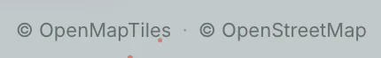

| What | Licence | Where to read it |
|---|---|---|
| Dezfil | Apache License 2.0 | [LICENSE](../../LICENSE) |
| The code it borrows, its palettes, icons and fonts, and the tools in its image | Each project's own | [NOTICE](../../NOTICE) |
| The packages the app is built from | Each package's own | [package-lock.json](../../package-lock.json) |
| The data of the built-in basemaps | ODbL, © OpenStreetMap contributors | [openstreetmap.org/copyright](https://www.openstreetmap.org/copyright) |
| The data of the templates | Each source's own | [NOTICE](../../NOTICE), and the template's own map |

## The licence

Dezfil is released under the Apache License 2.0. You may use, change and share it, in commercial work too. When you share it or a changed version, include the licence and NOTICE, and mark the files you changed. The licence carries a patent licence from each contributor and comes without warranty. Code you contribute takes the same terms: see [Contributing](../../CONTRIBUTING.md).

## Read the notices in your instance

The container image carries both files in `/app`. On an instance you run with Docker:

```sh title="Terminal"
docker exec dezfil cat /app/NOTICE
```

- `dezfil` is the container's name, as [Install](../start/install.md) sets it.
- `/app/NOTICE` lists the code Dezfil borrows and the components of the image. `/app/LICENSE` holds the licence text.
- Chromium and the other Debian packages in the image keep their licences under `/usr/share/doc`.

```text title="Output"
Dezfil
Copyright 2026 Siavash Saki

Licensed under the Apache License, Version 2.0 (see LICENSE).
...
```

## Libraries and tools

Dezfil is built on these projects. [NOTICE](../../NOTICE) lists the code it borrows and the components of its container image. [package.json](../../package.json) names each package the app depends on directly, and [package-lock.json](../../package-lock.json) the licence each installed package declares.

| Kind | Project | Licence | What it does in Dezfil |
|---|---|---|---|
| Rendering | MapLibre GL JS | BSD-3-Clause | Draws the basemap |
| Rendering | deck.gl | MIT | Draws your layers |
| Rendering | loaders.gl | MIT | Reads vector tiles in the browser |
| Rendering | PMTiles | BSD-3-Clause | Serves the tiles of large layers from their archives |
| Query engine | DuckDB, with its spatial, httpfs, json, postgres, azure and aws extensions | MIT | Runs your SQL and your imports |
| Query engine | DuckDB's h3 extension, with Uber's H3 library | Apache-2.0 | H3 cells: the **Assign H3 cells** and **Hotspot analysis (Getis-Ord Gi\*)** tools, and H3 cell columns read as places |
| App shell | Next.js and React | MIT | The app's pages and its API |
| App shell | better-sqlite3 | MIT | Keeps maps, accounts and settings in SQLite |
| App shell | React Flow | MIT | The workflow canvas |
| App shell | CodeMirror | MIT | The SQL editor |
| App shell | Model Context Protocol SDK | MIT | The MCP server that AI agents connect to |
| Tools in the image | Tippecanoe 2.79.0 | BSD-2-Clause | Builds the tiles of large layers |
| Tools in the image | Chromium | Its own licences | Draws map images on the server |
| Tools in the image | libvips, loaded by sharp | LGPL-3.0-or-later | An image library, kept as a shared library you can replace with another build |

The DuckDB extensions are built into the image, so an instance loads them without a network.

The extensions carry libraries of their own, such as GEOS under the LGPL-2.1. NOTICE lists each one.

## Fonts

All five fonts are under the SIL Open Font License 1.1. The instance serves them itself, so no page loads them from another site.

| Font | Where you see it |
|---|---|
| Gabarito, Inter and DM Mono | The app |
| Archivo and IBM Plex Mono | Published maps |

## Palettes and icons

| Project | Licence | In Dezfil |
|---|---|---|
| ColorBrewer | Apache-2.0 | **Greys**, **Blues**, **Greens**, **Reds**, **YlOrRd**, **RdBu**, **PiYG**, **Spectral**, **Paired**, **Dark2**, **Set3** |
| matplotlib | CC0 | **Viridis**, **Plasma**, **Inferno** |
| Tableau 10, as published in matplotlib | matplotlib licence | **Tab10** |
| Turbo | Apache-2.0 | **Turbo** |
| Scientific colour maps | MIT | **Berlin** |
| kepler.gl | MIT | **Global Warming**, **Sunrise**, **Viz Sequential**, **Ice & Fire**, **Viz Qualitative**, and the colors new layers take in turn |
| CARTO Colors | CC-BY 4.0 | **Bold** |
| Maki | CC0 | The symbols of the icon layer |
| Feather Icons | MIT | The settings gear |

## Map data credits



The built-in basemaps **Dark**, **Light** and **Streets** come from OpenFreeMap. Their data is © OpenStreetMap contributors under the ODbL, and their styles follow the OpenMapTiles schema, whose terms ask for the © OpenMapTiles credit.

On a map, their credit reads **© OpenMapTiles · © OpenStreetMap**, each part a link. OpenFreeMap's terms make naming OpenFreeMap optional, so the line leaves it out. The **Libraries** tab of **Settings**, which admins see, names it under each built-in style: **OpenFreeMap · built in**.

The credit follows the basemap a map is on, in these places:

| Where | What you see |
|---|---|
| A map in the builder, or a template you open | The credit in the map's lower right corner |
| A published or embedded map | The credit in the lower right corner, with **made with Dezfil** |
| An image you export | The credit drawn into the image, with **Made with Dezfil**. |
| Pictures of your maps on **Home**, **Maps** and a project's page | **Map previews:** and the credits of the basemaps they were drawn on, at the foot of the page or list |
| Template pictures on **Templates** | **Map previews:** and the built-in credit, at the foot of the page |
| The basemap pickers | **Previews:** and the built-in credit, under the style thumbnails |
| Smaller maps, such as a dataset's map or a SQL result's map | The style's own credit in the map's corner. It folds behind the ⓘ button once you move the map. |
| The builder's **Search map & places** box | The address finder's own credit, under the places it finds |

To export an image, see [Share and publish](../use/share-and-publish.md#export-an-image).

## Credit your own basemap

Dezfil ships no satellite imagery. An instance that offers **Satellite** brings its own tile address and the credit its provider asks for.

| Basemap | The credit it shows | Where it comes from |
|---|---|---|
| **Satellite** | The text in **Credit** | **Settings** › **Libraries** › **Satellite imagery**, which an admin sets, or `DEZFIL_SATELLITE_ATTRIBUTION` |
| A style an admin adds with **Add a style**, in **Settings** › **Libraries** | The credit the style itself names, or its host name when it names none | Read from the style when it is added |
| A style address on one map, through **Custom…** in the builder | The same | Read from the style when the map saves it |
| The deployment's own style, `DEZFIL_BASEMAP_URL` | The text of `DEZFIL_BASEMAP_ATTRIBUTION` | Its variable |

[Basemaps and imagery](../self-host/configuration/libraries.md) holds these settings, with their defaults. To serve the basemap from your own servers, see [What leaves the instance](../self-host/what-leaves-the-instance.md#keep-requests-on-your-own-network).

## Credit the data on your maps

Each template's map credits its sources in a **Note** widget titled **Sources**. For the templates that come with Dezfil, [NOTICE](../../NOTICE) also lists each source, its licence and the credit it asks for, under Shipped templates.

The templates' data stays under those licences, not under Dezfil's Apache-2.0.

Templates your server downloads from the catalogue credit their sources the same way, in their own maps.

Your copy of a template keeps the **Sources** note. A published map shows it while **Show widgets on published view** is on, in the **Widgets** tab. Copies of the templates that come with Dezfil start with it on.

A dataset you copy from a template carries no credit of its own. When you put it on another map, add a **Note** widget there that names its source. [Widgets and tools](../use/widgets-and-tools.md#add-a-widget) shows how to add one.

Data you import keeps its source's licence too, so credit it the same way, in a **Note** widget. OpenStreetMap data, for example, is under the ODbL and asks for the credit © OpenStreetMap contributors.

## Other credits

| Source | Licence | Where Dezfil uses it |
|---|---|---|
| Natural Earth | Public domain | The coastlines in the app's background |
| NASA Blue Marble Next Generation | Public domain | The **Satellite** thumbnail in the basemap pickers |
| The OpenStreetMap, Overture Maps and PostgreSQL logos | Marks of their owners; the OpenStreetMap logo under CC-BY-SA 2.0 | To name those sources in **Add data**, and PostgreSQL on **Connections** |
| The aerial picture on the sign-in page | Made for Dezfil with an AI image generator | The sign-in, setup and invitation pages |

## Next steps

- Copy a template and see its sources: [Templates](../use/templates.md).
- Choose a basemap for a map: [Build a map](../use/build-a-map.md#4-choose-the-basemap).
- Export an image with its credit: [Share and publish](../use/share-and-publish.md#export-an-image).
- Serve basemaps from your own servers: [What leaves the instance](../self-host/what-leaves-the-instance.md#keep-requests-on-your-own-network).
