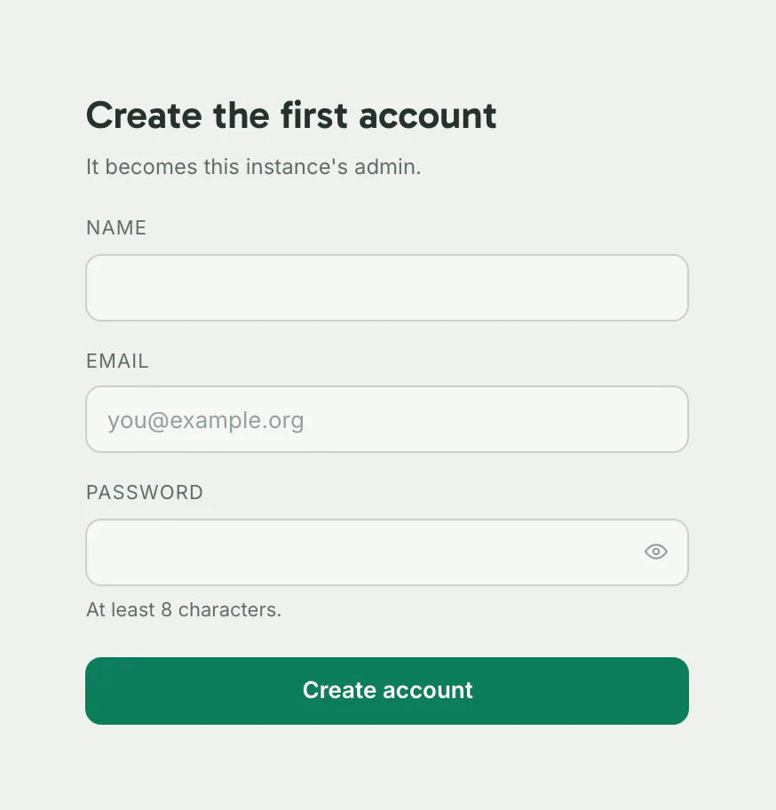

Start from this skeleton. Save it as `docs/<section>/<page>.md`, its name in lowercase letters, digits and hyphens.

```markdown title="docs/<section>/<page>.md"
---
title: "<Page title>"
summary: "<One sentence: what the reader does with this page.>"
read_when:
  - "<a situation, in the reader's words>"
  - "<another situation, up to five>"
audience:
  - <user, operator, developer or agent>
checked: none
order: <the page's place in its section>
---

<A command, a picture, a table or step 1.>

## 1. <The first action>

<One action.> You should see <what the reader sees>.

## 2. <The next action>

<One action.> You should see <what the reader sees>.

## Troubleshooting

### <The symptom, as the reader meets it>

<The fix.>

## Next steps

- [<Page title>](<relative/path.md>): <what the reader does there>.
```

Then write the index and check every page, from the repository root:

```sh title="Terminal"
npm run docs:write
```

```text title="Output"
Wrote docs/api/openapi.json.
Wrote the settings tables, unchanged.
Wrote docs/README.md.
PASS: <N> pages hold the page contract; <N> hold the writing rules, <N> on the list of pages not yet rewritten; the links in <N> procedure notes resolve; the index, the API description file and the <N> settings tables are current. The image manifest matches its files.
```

## Pick the section

| Folder | Section | Its pages |
|---|---|---|
| `start` | Get started | What Dezfil is, how to install it, and your first map. |
| `use` | Use Dezfil | Do things in the app: data, maps, SQL, workflows and sharing. |
| `self-host` | Self-host | Install, secure, configure and back up your own instance. |
| `api` | API and agents | Script Dezfil over HTTP, or connect an AI agent through MCP. |
| `contribute` | Contribute | Work on Dezfil's code. |
| `about` | About | Licence, credits, changes and policies. |

A page at `docs/<section>/<page>.md` serves at `https://dezfil.io/docs/<section>/<page>/`. A section holds at most one level of subfolder, such as `self-host/configuration/`.

## Frontmatter

| Field | Required | What it holds |
|---|---|---|
| `title` | Yes | The page's name, short. The body has no first-level heading and skips no heading level. |
| `summary` | Yes | One task-phrased sentence of at most 160 characters. The site shows it under the title. |
| `read_when` | Yes | One to five situations in the reader's words, such as "you run Dezfil behind a reverse proxy". |
| `audience` | Yes | One or more of `user`, `operator`, `developer` and `agent`. A contributor is a `developer`. |
| `checked` | Yes | `none`, or the package version the whole page was read against on a running instance of that version. |
| `checked_on` | With a version | The date of that reading, as `YYYY-MM-DD`, never in the future. |
| `order` | No | A whole number: the page's place in its section. Pages without one follow, by title. |
| `moved_from` | No | The old site addresses of a page that moved, such as `/docs/<section>/<old-page>/`. The site redirects each one. |

After you add, move or delete a page, or change its title, summary, `read_when`, `audience` or `order`, run `npm run docs:write`. It regenerates the index, `docs/README.md`; until you do, `lint:docs` fails with `index.stale`.

## The writing rules

- **Voice:** Second person, present tense, active voice and plain words, for someone who wants to do something with Dezfil.
- **Opening:** After the title and summary comes something to do or see: a command, a picture, a table or step 1. No preamble.
- **Length:** One idea per paragraph. Aim for 15 to 30 words, in sentences of 15 to 20; shorter is fine. A bigger subject splits into an overview and a page per area.
- **Show, then explain:** The command, then a short list of what its parts do, then what you should see: a block titled Output, or a picture.
- **Steps:** Numbered headings (`## 1. Start the instance`) or a numbered list. One action per step, each with its check: "You should see …".
- **Code:** Every block names its language and a title. Placeholders look like `<YOUR_TOKEN>`. A request is followed by its answer.
- **Alternatives:** Docker or Docker Compose, curl or JavaScript, one client or another: a [tab set](#tabs).
- **Side cases:** Off the main path. One [notice](#notices) per second-level section at most, a Troubleshooting section at the end, or a link to the page with the detail.
- **Exact rules:** Every setting, limit, operation and error code lives in a table or in the generated reference. Each fact has one home, and other pages link to it.
- **True of the code:** UI labels are the app's own words, found in `src/` and set in bold (**Add data**), even when one holds an avoided word (**Check now**). Every command, flag, variable, default and path is read from the code at the branch the page ships on.
- **Bold:** Only for UI labels, and for a short lead-in ending in a colon at the start of a list item or a troubleshooting entry, as here.
- **Never in a page:** The development record (spec numbers, registry rows, phases, review rounds, proof runs, probes, seeds, test names), history words, disclaimers and em dashes. Outside Contribute, also source paths, check and test commands, and test-only settings. See [Words to avoid](#words-to-avoid).
- **`read_when`:** Situations in the reader's words, each answered on the page or by a link it gives.

## Check a page

`npm run lint:docs` reads every file git tracks or does not ignore. Each problem is one line: file, line, rule id and what to change.

````text title="Output"
docs/use/sql.md:11: writing.opening: the first paragraph opens with "This page"; open with what the reader does or sees
docs/use/sql.md:11: writing.word: "now" tells a history or what is not promised; say what is true
docs/use/sql.md:13: writing.code-title: this code block has no title: name it after the language, such as ```sh title="Terminal"
FAIL: 3 documentation problem(s).
````

Lines count from the file's top, frontmatter included, and the command exits with status 1.

The page contract holds every page as well: its place (`tree.*`, `address.*`), its frontmatter (`frontmatter.*`, `moved-from.*`), headings (`body.*`), links (`link.*`), pictures (`image.*`, `manifest.*`) and the files `npm run docs:write` generates (`index.stale`, `description.stale`, `settings.*`).

After moving a page or changing a link, also run `npm run lint:retired-paths`: it fails on a tracked file naming one of its listed docs paths that moved or left.

## The checks

| # | What `lint:docs` holds | Pages | Rule id |
|---|---|---|---|
| 1 | No paragraph, list item or notice is over 80 words. | Every page | `writing.paragraph-length` |
| 2 | On a page with five or more paragraphs, the median paragraph is at most 30 words. The median of an even count is the mean of the two middle ones. | Every page | `writing.median-paragraph` |
| 3 | A page holds at most 1,500 words of prose. | Every page | `writing.page-length` |
| 4 | A code block, picture, recording, table or numbered step comes before the 151st word of prose. A numbered step is an item of a numbered list, or a heading that begins with a step number, such as `Step 1` or `1.`. | Get started, Use Dezfil, Self-host, API and agents | `writing.first-screen` |
| 5 | Every code block names a language and a title. | Every page | `writing.code-language`, `writing.code-title` |
| 6 | Every tab set is well formed, as [Tabs](#tabs) shows. | Every page | `writing.tabs-count`, `writing.tabs-label`, `writing.tabs-unclosed`, `writing.tabs-outside`, `writing.tabs-form` |
| 7 | A notice is a `NOTE` or `WARNING` alert of at most 50 words, and a second-level section holds at most one. | Every page | `writing.notice-kind`, `writing.notice-length`, `writing.notice-count` |
| 8 | Outside code and bold: no em dash, and none of the history words or disclaimers of [Words to avoid](#words-to-avoid). | Every page | `writing.em-dash`, `writing.word` |
| 9 | Outside code and bold: no term of the development record. | Outside Contribute | `writing.record-term` |
| 10 | In prose or code: no source path, no check or test command, no test variable. | Outside Contribute | `writing.repository-path`, `writing.check-command`, `writing.test-setting` |
| 11 | The first paragraph does not open with `This page`, `This guide` or `This section`. | Every page | `writing.opening` |
| 12 | A variable or Settings key the settings tables document, or an error code of the API description, that a `read_when` line names appears in the page's body. A code that reads as a plain word, such as `forbidden`, counts only when the `read_when` line sets it in backticks. | Every page | `writing.read-when-name` |
| | Every line of the list of pages not yet rewritten names a page, once. | The list | `writing.list-entry` |

The checks measure the page as Markdown parses:

| What | How it counts |
|---|---|
| Paragraphs, footnotes, list items and notices | As prose. A nested list item counts on its own. |
| Headings, tables, code blocks, HTML comments, the lines of a tab set, and a region between `<!-- <name>:start -->` and `<!-- <name>:end -->`, which a script writes | Not as prose |
| A link | By its text, not its address |
| Inline code, and a picture's alternative text | Inline code counts; the alternative text does not |
| A word | A run of letters and digits, so `don't` is two words, and so is `1,500` |

The four imported documents, such as `CHANGELOG.md`, and the site's own pages are outside these checks.

## Words to avoid

| Form | Fails on |
|---|---|
| `—` (an em dash, U+2014) | Every page |
| `now`, `previously` | Every page |
| `no longer`, `is not claimed`, `does not establish`, `is not promised` | Every page |
| `used to`, unless after a form of "be" (`is used to`, `is not always used to`) | Every page |
| `proof`, `probe`, `seed`, `seeded`, `red-proven`, `gate`, `spec`, and their plurals | Outside Contribute |
| A path that begins `src/`, `e2e/`, `test-support/`, `.github/` or `.claude/` | Outside Contribute |
| A `scripts/` path other than `scripts/admin-recover.mjs`, the account recovery script the image ships | Outside Contribute |
| `npm test`, or `npm run` with a script whose name begins `test`, `lint` or `docs` | Outside Contribute |
| A variable that begins `DEZFIL_TEST_` | Outside Contribute |
| `This page`, `This guide` or `This section` at the start of the first paragraph | Every page |

The words rules read paragraphs, list items, notices, headings, table cells, tab labels and code block titles. Code and bold are exempt, so **Check now** passes. Paths, commands and variables fail in code too.

## Code blocks

Show, then explain:

````markdown title="Example"
```sh title="Terminal"
docker run -d --name dezfil -p 127.0.0.1:3000:3000 -v dezfil-data:/data dezfil
```

- `-p 127.0.0.1:3000:3000` serves Dezfil on port 3000 of this machine only.
- `-v dezfil-data:/data` keeps everything Dezfil stores in the `dezfil-data` volume.

Check it:

```sh title="Terminal"
curl http://localhost:3000/api/health
```

```json title="Output"
{"status":"ready"}
```
````

| Part | Rule |
|---|---|
| After the fence | The language, then `title=` and the title in double quotes. The site also reads single quotes, or one unquoted word. |
| The title | Terminal for a shell block, a file's name for a file (`compose.yaml`), Output for an answer |

## Tabs

````markdown title="Example"
::::tabs

:::tab[Docker]

```sh title="Terminal"
docker logs -f dezfil
```

:::

:::tab[Docker Compose]

```sh title="Terminal"
docker compose logs -f
```

:::

::::
````

- A set opens with a `::::tabs` line and closes with a `::::` line.
- Each tab opens with a `:::tab[<Label>]` line and closes with a `:::` line. A set holds two or more tabs, each labelled differently.
- Nothing stands in a set outside its tabs, and sets never nest.
- A tab holds any content: code, a list, a notice.

The site keeps a reader's choice by label across pages, so give one choice one label everywhere. GitHub and the served Markdown show every tab in order, so each must read alone.

## Notices

```markdown title="docs/start/install.md"
> [!WARNING]
> The first person to finish setup becomes the admin. Keep the instance private until you have created your account.
```

- A notice is a `[!NOTE]` or a `[!WARNING]` alert, its marker alone on the first line.
- It holds at most 50 words: a sentence or two.
- A second-level section holds at most one. The text before the first heading counts as a section.
- A plain quote, a `[!TIP]` or a colon block such as `:::note` fails.

## Links

| To reach | Write | Such as |
|---|---|---|
| Another page | Its relative path to the `.md` file | `../start/install.md` |
| A heading | The page's path and the heading's anchor | `../start/install.md#everyday-commands` |
| The docs home, a section page or the operation reference | The full site address | `https://dezfil.io/docs/api/reference/` |
| The API description | Its relative path, or its full site address | `../api/openapi.json` |
| A file in the repository | Its relative path | `../../NOTICE` |
| Another site | Its address | `https://example.org/` |

`lint:docs` fails a link that leads nowhere (`link.dead-page`, `link.dead-file`), one that starts with `/` (`link.not-relative`), and a generated page reached by a relative path or a `/docs/` address (`link.generated-not-full`).

## Pictures

```markdown title="docs/start/install.md"

```

- The alternative text says what the picture shows. A picture without it fails `image.no-alt`.
- A picture lives under `docs/images/<section>/` as `<page>-<what>.webp`, a recording as `.webm`.
- The page names the light take; the dark take sits beside it with `.dark` before the extension.

`npm run docs:pictures` takes both from a real instance and writes their rows in `docs/images/manifest.json`. A picture without a row fails `image.not-in-manifest`.

### 1. Add the scene

Add an entry to `scripts/docs-pictures-scenes.mjs`: its `id`, its light take's `file`, the `pages`, its `kind`, its `state`, how to `open` it and, for less than the full frame, a `crop`. A map scene sets `map: true`. A recording also takes a `poster` and its `steps`.

### 2. Take it

In a detached worktree of your branch with no `.env` files:

```sh title="Terminal"
npm ci
npx playwright install chromium ffmpeg
npm run build
npm run docs:pictures -- --only setup-card
```

- `npx playwright install chromium ffmpeg` installs the browser the script drives and the ffmpeg a recording needs.
- `--only` takes scene ids, separated by commas. Without it, the script takes every scene.
- `--port` picks its server's port, above 1024 and never 3000; by default, a free one.

```text title="Output"
setup-card: start/setup-card.webp, 874 × 912, <BYTES> bytes
setup-card: start/setup-card.dark.webp, 874 × 912, <BYTES> bytes
The server opened no request: the observer's file is empty.
2 file(s) taken: <N> changed, <N> unchanged, 0 removed.
Run npm run docs:write if the manifest is new, then npm run lint:docs.
```

It serves the build on loopback over scratch data, and fails if the server or the browser reaches another host. See [What a run does](../../scripts/docs-pictures.md#what-a-run-does).

### 3. Commit it

Copy the changed files and the manifest to your branch and commit them. `npm run lint:docs` should end with `The image manifest matches its files.`

A picture is at most 250,000 bytes. A recording is at most 1,500,000 bytes and 8 seconds, and the scene list holds at most 12 recordings. Over a bound, declare a crop, or hold fewer frames.

## Take a page off the list

`scripts/docs-not-rewritten.txt` lists, one per line, the pages the writing rules skip until they are rewritten. Every other check holds them.

1. Rewrite the page under the rules above.
2. In the same change, delete its line from `scripts/docs-not-rewritten.txt`.
3. Run `npm run lint:docs`. You should see one page more that holds the writing rules, and one fewer on the list.

A page never returns to the list.

## Change a rule

The writing rules live in `scripts/docs-writing.mjs` and the page contract in `scripts/docs-contract.mjs`; `scripts/docs.mjs` runs both. Their cases are in `test-support/docs-contract/cases.json`.

- A writing case carries `"scope": "product"` and its expected problems, each with file, rule and line.
- A changed rule ships with a failing case and a passing one at its boundary, such as 81 words beside 80.
- `npm test` runs the cases in `src/lib/docs-writing.test.ts`, runs every failing one but the `read_when` cases through the `lint:docs` command too, and fails when a rule id has no failing case.

Run them alone with `npx vitest run src/lib/docs-writing.test.ts`.

## Troubleshooting

### `writing.first-screen`

More than 150 words of prose come before anything to do or see. Move the command, picture, table or step 1 up, or cut the words before it.

### `writing.median-paragraph`

The median paragraph runs over 30 words. Split each long one at its second idea, or turn a run of parallel facts into a list or a table.

## Next steps

- [Development setup](development-setup.md): run a checkout, the checks and the tests.
- [How this is built](how-this-is-built.md): how a change is specified, written and reviewed.
- [Contributing](../../CONTRIBUTING.md): get a change from your machine into the project.
- Model pages: [Your first map](../start/first-map.md) and [Install](../start/install.md).
