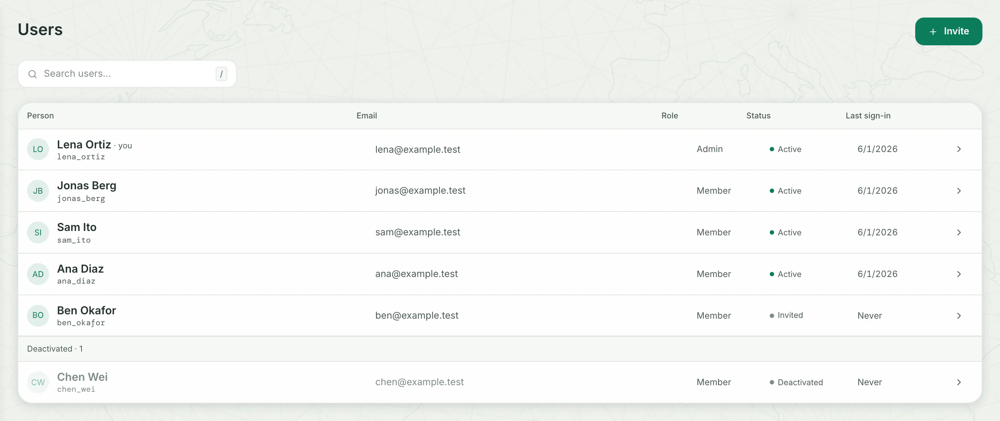

Admins manage every account on the **Users** page. Open **Users** in the side menu; members do not see it. Nobody signs up alone: an admin adds each person.

| To | Do this on **Users** |
|---|---|
| Add a person | Click **Invite** |
| Make someone an admin | Open their row and click **Make admin** |
| Reset a forgotten password | Open their row and click **Reset password** |
| Close an account and keep its work | Open their row and click **Deactivate** |
| Delete an account and its work | Deactivate it, then click **Delete account** |
| Get in when no admin can sign in | Run the [recovery script](#recover-the-admin-account) on the server |

## Add a person

1. On **Users**, click **Invite**. A row opens at the top of the list, with **Name** and **Email** fields.
2. Type the person's name and email address. To make them an admin from the start, tick **Admin**.
3. Click **Create account**. You should see **Account created for Ana Diaz**, and the row opens on the **Sign-in link**.
4. Click **Copy link**. You should see **Copied** on the button.
5. Send the link to the person yourself, by chat or email, then click **Done**.

Dezfil sends no email. The link shows once: after **Done**, you can only make a new one. The person's **Status** reads **Invited** until they use it.

They open the link, see **Choose your password**, type a **Password** and click **Set password**. Dezfil signs them in, and their status turns **Active**.

The line under the field names the shortest password: 8 characters, unless you raise it in **Settings** › **Security** › **Shortest password**. Very common passwords are refused.

A link lasts 7 days. To change that, open **Settings** › **Security** and pick 1, 3, 7 or 14 days in **Invite and reset links last**. Each link keeps the lifetime it was made with.

> [!NOTE]
> The link starts with the address you opened Dezfil at. Invite people while you use the address they will use, such as `https://maps.example.com`, not `http://localhost:3000`.

## Make someone an admin

1. Click the person's row to open it.
2. Click **Make admin**. You should see **Ana Diaz: admin access granted**, and **Admin** in the **Role** column.

To take admin access away, open the row and click **Remove admin**. Everyone who is not an admin is a **Member**.

| An admin | A member |
|---|---|
| Opens **Users** and manages every account | Does not see **Users** |
| Changes the instance in the **Instance** tabs of **Settings** | Sees only **General** under **Instance**, and cannot change it |
| Publishes maps, makes API tokens, adds database connections and imports from links when a rule says **Admins only** | Sees a line such as **Only admins can publish maps on this instance.** |

Each account's maps, workflows and datasets are private, including from admins, until a project's owner shares the project. An admin reaches them as anyone does, through a project shared with them, as [Share and publish](../use/share-and-publish.md) describes.

Your own row offers only **Change password**: you cannot remove your own admin access or deactivate yourself. Another admin does that, and Dezfil always keeps at least one active admin.

## Reset a password

1. Open the person's row and click **Reset password**. You should see **The current password and earlier links will stop working. Browser sessions will end; API tokens stay valid.**
2. Click **Reset password** again to confirm. You should see the **Sign-in link** and when it expires.
3. Click **Copy link**, send the link to the person, then click **Done**.

They open the link and choose a new password, as a new person does. For someone who has not used their invitation, the button reads **New sign-in link**. A new link replaces every earlier one.

The sign-in page tells people who forgot their password: **Forgot your password? An admin can reset it.** To name someone else, such as your GIS team, type it in **Settings** › **General** › **Lost password contact** and click **Save**.

To change your own password, see [Your settings](../use/settings.md).

## Deactivate or delete an account

To close an account and keep its work:

1. Open the person's row and click **Deactivate**. You should see **Browser sessions will end and API tokens will lose access. Their work stays here.**
2. Click **Deactivate** again. You should see **Ana Diaz: deactivated**, and the row under **Deactivated · 1**.

The person cannot sign in. Their maps, workflows, datasets and projects stay where they are: people who reach them can open them and copy a map or workflow, but nobody can change them. Their published maps stay public.

To undo it, open the row and click **Reactivate**. Everything returns to the same person.

To delete an account with everything it owns:

1. Deactivate the account first. An invitation nobody used can be deleted at once.
2. Open the row and click **Delete account**. The dialog counts what goes with it: maps, datasets, workflows, projects, connections and published links, and the people who lose access.
3. Type the account's email in the box, where the dialog asks for it, and click **Delete account**. You should see **Ana Diaz: deleted**.

> [!WARNING]
> Deleting cannot be undone. It removes everything the account owns, wherever it is filed, and takes its published maps offline. To keep someone's work for the team, leave the account deactivated.

Changes the account made to other people's maps and workflows then show **Deleted account** as their author. Deleting also empties the caches of the address finder, travel time and OpenStreetMap.

To finish a deletion, Dezfil rewrites its metadata database, and answers no request until that ends, health checks included. The pause grows with the database, and a slow disk makes it longer. It needs free disk space of up to twice the database's size.

## Recover the admin account

If no admin can sign in, run the recovery script on the server. It prints a one-time link with which an admin account chooses a new password.

::::tabs

:::tab[Docker]

```sh title="Terminal"
docker exec -it dezfil node scripts/admin-recover.mjs \
  --data-dir /data --origin <YOUR_DEZFIL_ADDRESS> --email <ADMIN_EMAIL>
```

If the container is stopped, run the script in a one-off container on the same volume:

```sh title="Terminal"
docker run --rm -it -v dezfil-data:/data dezfil \
  node scripts/admin-recover.mjs --data-dir /data --origin <YOUR_DEZFIL_ADDRESS> --email <ADMIN_EMAIL>
```

:::

:::tab[Docker Compose]

Run this in the folder that holds your `compose.yaml`:

```sh title="Terminal"
docker compose exec dezfil node scripts/admin-recover.mjs \
  --data-dir /data --origin <YOUR_DEZFIL_ADDRESS> --email <ADMIN_EMAIL>
```

If Dezfil is stopped, run the Docker tab's one-off command: it uses the same volume and image.

:::

:::tab[From source]

Run this in your checkout:

```sh title="Terminal"
npm run admin:recover -- \
  --data-dir ./data --origin <YOUR_DEZFIL_ADDRESS> --email <ADMIN_EMAIL>
```

If you set `DEZFIL_DATA_DIR`, give `--data-dir` that folder instead.

:::

::::

- `-it` gives the script your terminal. Without one it refuses to run, so the link never lands in a pipe or a log. `docker compose exec` gives one by itself.
- `--data-dir` is the folder that holds the instance's data: `/data` in the container.
- `--origin` is the address people open Dezfil at, such as `https://maps.example.com` or `http://localhost:3000`, with no path. The link starts with it.
- `--email` picks the admin account. When the instance has exactly one active admin, you can leave it out.

```text title="Output"
Account: "admin@example.com"
Expires: 2026-10-20T14:15:00.000Z
https://maps.example.com/accept#secret=<SECRET>
```

1. Open the link within 15 minutes; the expiry is in UTC. You should see **Choose your password**.
2. Type a new **Password** and click **Set password**. You should see **Home**, or the landing page your instance opens on, signed in as that admin.

The script works with the server running or stopped, and a second run replaces the link. It ends that account's old password, earlier links, browser sessions and API tokens, so make new tokens in **Settings** › **API & MCP**. Other accounts keep theirs.

The script reaches only an account that is an active admin. It never makes an admin, reactivates an account or sets up a new instance.

> [!NOTE]
> If someone else took over the instance, the script lets you back in but leaves their accounts and changes in place. Restore a backup from before, as [Back up and restore](backup-and-restore.md) describes.

## Troubleshooting

### The person sees "This sign-in link is unavailable."

The link expired, was used, or was replaced by a newer one, or the account is deactivated. Open their row, click **New sign-in link** or **Reset password**, and send the new link. A deactivated account needs **Reactivate** first.

### Creating an account says "This account is deactivated. Reactivate it in Users."

That email belongs to a deactivated account. Click **Reactivate existing account** under the message to open it again, with its work.

### Creating an account says "An account already uses this email address."

The person has an account already. Type their email in **Search users…** to find it.

### A row says "Deletion unfinished"

Dezfil could not delete everything yet, for example for want of disk space. The account stays closed: nobody can sign in to it or open its work. Free the space, then open the row and click **Finish deleting**.

A program outside Dezfil that keeps the database open, such as a replication tool, also stops a deletion from finishing. Stop it first.

### The script says "Run admin recovery in a terminal."

The script had no terminal to print to. Add `-it` to `docker exec` or `docker run`. With Docker Compose, leave out `-T`.

### The script says "Several active admins exist. Select one with --email."

Add `--email` with the email of the admin account you want back.

### The script says "That email does not identify an active admin. No credentials changed."

Check the spelling. The account must be an admin and active, and the script cannot change either. If another admin can sign in, they do it on **Users**.

### The script says "Supply an explicit reachable HTTP/HTTPS instance origin"

Give `--origin` the address alone, starting with `http://` or `https://`, such as `https://maps.example.com`: no path, no query, no user name.

### The script says "No setup-complete store found."

`--data-dir` names a folder without the instance's data, or setup never finished. In the container, the folder is `/data`. On a new instance, open Dezfil and create the first account.

### The script says "Incompatible metadata store."

The script comes from another Dezfil version than the data. Run it in the instance's own container, or with the image that last ran on the volume.

### The script says "The metadata store stayed busy for five seconds."

Another process was writing to the data. Wait a moment and run the script again. Nothing changed.

## Next steps

- Share work with the people you added: [Share and publish](../use/share-and-publish.md).
- Change how long people stay signed in, and the other sign-in rules: [Security and rules](configuration/rules.md).
- Keep a copy of the data, accounts included: [Back up and restore](backup-and-restore.md).
- Manage accounts from a script: [How the API works](../api/http-api.md).
