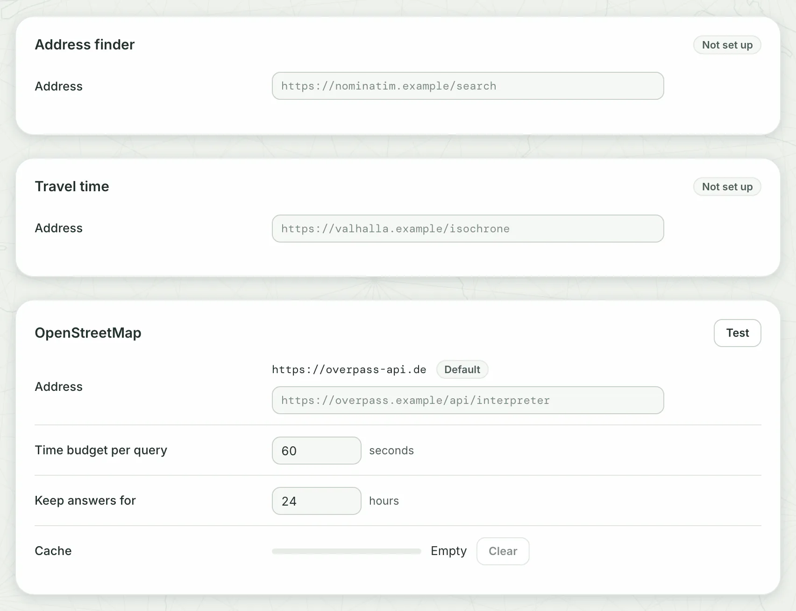

Out of the box, Dezfil reaches four outside services, each only when a feature needs it. Other services stay off until you set them up, and people can give addresses of their own.

## On out of the box

| Destination | Reached when | What it receives | To turn it off or point it elsewhere |
|---|---|---|---|
| Basemap tiles at `tiles.openfreemap.org`, from browsers | A browser draws a map on a built-in style: in the builder, on a published map or an embed, in a preview map | Requests for the style and what it names (tiles, fonts, icons) for the area in view, from the visitor's IP address | `DEZFIL_BASEMAP_URL`, and hide the built-in styles: see [Keep requests on your own network](#keep-requests-on-your-own-network) |
| The same tile host, from the server | The server draws a map's card picture, on its own after the map changes; an image export through the API; a picture for the assistant's map check | The same requests, for the map's area, from your server | Follows the map's basemap |
| The template catalogue: the release files of `github.com/Dezfil/templates`, and the hosts GitHub redirects them to | Someone opens **Home** or **Templates**, at most once in ten minutes, or thirty seconds after a failed read; someone opens or copies a template that is not downloaded yet | Requests for the catalogue's index, its pictures and a template's archive, with no credential | Turn off **Catalogue** on the **Templates** card, or point **Catalogue address** there or `DEZFIL_TEMPLATES_CATALOGUE` at a mirror, as a firewall that lists hosts needs: see [step 3](#3-turn-off-the-template-catalogue) |
| OpenStreetMap's public Overpass server, `overpass-api.de` | Someone previews or imports from **OpenStreetMap** in **Add data**, or refreshes a dataset imported from it | The Overpass query: the area and the tags chosen, or the person's own query | `DEZFIL_OVERPASS_URL`, or **Address** on the **OpenStreetMap** card |
| Overture Maps' public bucket on Amazon S3, `overturemaps-us-west-2`: the listing at `overturemaps-us-west-2.s3.us-west-2.amazonaws.com`, the files on Amazon S3's hosts | Someone opens **Overture Maps** in **Add data**, which lists the releases (a listing that worked is kept six hours), imports from it, or refreshes a dataset imported from it | A listing of the releases, then reads of the chosen release's files | No setting: see [What has no off switch](#what-has-no-off-switch) |

Every request the server makes shows the service your server's IP address. A request from a browser shows it the visitor's address instead.

Scripts, agents and the assistant reach the same services through the API.

Unless a row says otherwise, the cards these tables name are on **Settings** > **Data & services**, which only admins see. Most service cards there have a **Test** that sends one request and says how it answered.

Dezfil sends no email and reports nothing about itself: there is no telemetry. Links in the app, such as **Docs** in the side menu, open their sites only when someone clicks them.

> [!NOTE]
> Run from a checkout, the query engine downloads each extension it needs from DuckDB's servers the first time. The image ships them, so a container never downloads one.

## Off until you set them up



| Service | Turn it on with | Reached when | What it receives |
|---|---|---|---|
| An address finder (Nominatim-compatible) | `DEZFIL_GEOCODER_URL`, or **Address** on the **Address finder** card | Someone presses Enter in **Search map & places**, or runs **Geocode addresses** | The search text, or each address in the chosen column |
| A travel-time service (Valhalla-compatible) | `DEZFIL_ISOCHRONE_URL`, or **Address** on the **Travel time** card | Someone runs **Isochrone / travel-time area** | Each origin's coordinates, the travel mode and the time bands |
| Satellite imagery | `DEZFIL_SATELLITE_URL`, or **Tile address** on the **Satellite imagery** card of **Settings** > **Libraries** | A map on **Satellite** is drawn, in a browser or in a picture the server makes | Each tile's zoom, column and row, with the key in your template, from your server |
| The AI provider, `api.anthropic.com` or `api.openai.com` | `ANTHROPIC_API_KEY` or `OPENAI_API_KEY` | Someone sends a message to the assistant | The conversation and what the assistant reads: see [What the provider receives](assistant.md#what-the-provider-receives) |

To stop a service again, click **Remove** beside its saved address, then **Remove address**. An address a variable sets is locked in Settings and names its variable: unset the variable and replace the container, as [Set a variable](configuration.md#set-a-variable) shows.

A public geocoding service receives every address your people look up, and every distinct address of the column for **Geocode addresses**. Run your own if the addresses are not yours to share.

Satellite tiles pass through your server, so no browser contacts the imagery provider, a published map's readers included. A key limited to browser origins or referrers needs that limit lifted.

Check that the imagery provider's terms allow its tiles to pass through a server and appear on published maps.

## Addresses people give

People can also point the server at addresses of their own:

| Request | Reached when | What it receives | Controlled by |
|---|---|---|---|
| Web links (`https://`, `http://`) | Someone imports or refreshes a dataset from a **File URL** in **Add data** > **Files** | A request for the file | **Who may import from links**, for new imports |
| Cloud storage links (`s3://`, `gs://`, `az://`) | The same, for a cloud storage link | Anonymous reads from Google Cloud Storage and Amazon S3, or the store that `DEZFIL_S3_ENDPOINT` or **S3 address** on the **Cloud storage** card names | **Who may import from links**, for new imports |
| PostGIS databases | Someone tests a connection, browses it, or imports or refreshes from it | The connection's user name and password, and the queries | **Who may add database connections**, for a new connection or a changed host, port or database |
| Basemap styles from elsewhere | An admin adds a style on **Settings** > **Libraries**, or someone puts one on a single map. The server reads the style to check it, then every browser that draws a map on it loads it | The same requests as the built-in basemap | **Style addresses on single maps**, and the admins who add styles |

An `az://` link and a private bucket need `DEZFIL_OBJECT_STORE_CREDENTIALS` set to `true`. The server then signs cloud storage reads with its own credentials, so anyone who may import from links can read what the server can.

### Private addresses

The server refuses loopback, private-network, link-local and cloud metadata addresses for every request it makes on this page. The exceptions are the AI provider, Overture imports and cloud storage read with the server's credentials.

To let the server reach hosts on your own network, list them:

::::tabs

:::tab[Docker]

A new container has only the variables you give it. List yours first, as [Set a variable](configuration.md#set-a-variable) shows, and add them to the command, `DEZFIL_SECRET_KEY` among them:

```sh title="Terminal"
docker rm -f dezfil
docker run -d --name dezfil -p 127.0.0.1:3000:3000 -v dezfil-data:/data \
  -e DEZFIL_EGRESS_ALLOWLIST=<YOUR_HOST>,<YOUR_RANGE> \
  dezfil
```

:::

:::tab[Docker Compose]

Add the variable to the service in your `compose.yaml`, then run `docker compose up -d`:

```yaml title="compose.yaml"
services:
  dezfil:
    environment:
      DEZFIL_EGRESS_ALLOWLIST: "<YOUR_HOST>,<YOUR_RANGE>"
```

:::

::::

- `<YOUR_HOST>` is a hostname, such as `gis-db.internal`. A listed hostname is trusted whatever address it resolves to.
- `<YOUR_RANGE>` is an IP address or a CIDR range, such as `10.20.0.0/16`.

You should see your hosts on the **Private network** card of **Data & services**, under **Hosts the server may reach**, with **Set in the server's environment by `DEZFIL_EGRESS_ALLOWLIST`.**

Inside the container, `localhost` is the container itself.

For a database on the Docker host, use the host's address on Docker's network, which [Trust the proxy](reverse-proxy.md#2-trust-the-proxy) prints, such as `172.17.0.1`. List that address, and let the database accept connections on it.

## Keep requests on your own network

### 1. Point the server at your own services

::::tabs

:::tab[Docker]

List your variables first, as [Set a variable](configuration.md#set-a-variable) shows, and add them to the command, `DEZFIL_SECRET_KEY` among them:

```sh title="Terminal"
docker rm -f dezfil
docker run -d --name dezfil -p 127.0.0.1:3000:3000 -v dezfil-data:/data \
  -e DEZFIL_BASEMAP_URL=<YOUR_STYLE_URL> \
  -e DEZFIL_BASEMAP_ATTRIBUTION="<YOUR_CREDIT>" \
  -e DEZFIL_OVERPASS_URL=<YOUR_OVERPASS_URL> \
  -e DEZFIL_EGRESS_ALLOWLIST=<YOUR_TILE_HOST>,<YOUR_OVERPASS_HOST> \
  dezfil
```

:::

:::tab[Docker Compose]

Add the variables to the service in your `compose.yaml`, then run `docker compose up -d`:

```yaml title="compose.yaml"
services:
  dezfil:
    environment:
      DEZFIL_BASEMAP_URL: "<YOUR_STYLE_URL>"
      DEZFIL_BASEMAP_ATTRIBUTION: "<YOUR_CREDIT>"
      DEZFIL_OVERPASS_URL: "<YOUR_OVERPASS_URL>"
      DEZFIL_EGRESS_ALLOWLIST: "<YOUR_TILE_HOST>,<YOUR_OVERPASS_HOST>"
```

:::

::::

- `DEZFIL_BASEMAP_URL` is a MapLibre style address. Maps on **Auto**, the default for new maps, draw on it in both themes. Browsers load it directly, so it must be reachable from them.
- `DEZFIL_BASEMAP_ATTRIBUTION` is the credit line those maps show. Unset, they show none.
- `DEZFIL_OVERPASS_URL` sends **OpenStreetMap** imports to your Overpass server.
- `DEZFIL_EGRESS_ALLOWLIST` is needed only for hosts on a private network. It is one list: add these hosts to any you listed under [Private addresses](#private-addresses). The server draws map pictures through the same check, so list every host your style names: the style's own, and those of its tiles, fonts and icons.

You should see, in **Settings** > **System** > **Server settings**, the **Basemap address** and **Overpass endpoint** rows with your hosts and the **Source** **Environment**.

### 2. Hide the built-in basemaps

1. Open **Settings** > **Libraries**.
2. On the **Basemaps** card, turn off **Offered** for **Dark**, **Light** and **Streets**. You should see **Saved** beside each switch.
3. Turn off **Style addresses on single maps**, so nobody puts a map on a style the library does not offer. You should see **Saved** beside it.

Hidden styles leave every basemap picker, a published page's included. A map already on one keeps drawing it until its editor picks another basemap.

To offer more than your own default, add styles with **Add a style** on the same card. A style's address is public to anyone who sees a map drawn on it.

> [!NOTE]
> Preview maps always draw on the built-in Dark or Light style: on a dataset's page, under SQL and workflow results, and in the area pickers of **Add data** and **Add layer**. Where the tile host cannot be reached, they draw your data on a plain background.

### 3. Turn off the template catalogue

1. Open **Settings** > **Data & services**.
2. On the **Templates** card, turn off **Catalogue**. You should see **Off** beside the switch.

The three shipped templates, and any already downloaded, still open and copy.

To serve the catalogue yourself instead, save a mirror's `index.json` address as **Catalogue address** on the same card, or set `DEZFIL_TEMPLATES_CATALOGUE` to it.

The variable also takes a folder in the container, mounted with `-v` or under `volumes:`, that holds `index.json` and the files it names.

### 4. Choose who may give addresses

1. On **Settings** > **Data & services**, find the **Connections and imports** card.
2. Set **Who may import from links** and **Who may add database connections** to **Admins only**. You should see **Saved** beside each row.

Members keep the connections they already have, and datasets imported from links keep refreshing.

### What has no off switch

**OpenStreetMap** and **Overture Maps** stay in **Add data** for everyone. OpenStreetMap reaches the public Overpass server unless you point it at your own, and Overture Maps reads the public bucket. **Who may import from links** does not cover either.

Without a connection to them, an import from either fails and says why.

## Trust a private certificate authority

When your own services use certificates from a private authority, the container must trust it twice: in the server for its own requests, and in Chromium for map pictures.

### 1. Make Chromium's trust stores

On the host, with `certutil` from the NSS tools, in the folder that holds your root certificate `private-root.pem`:

```sh title="Terminal"
for store in legacy-nss current-nss; do
  mkdir -p "$store"
  NSS_TRUST_TYPE=NSS certutil -N -d "sql:$store" --empty-password
  NSS_TRUST_TYPE=NSS certutil -A -d "sql:$store" -n 'Private root' -t 'C,,' -i private-root.pem
done
docker run --rm --user root --entrypoint sh -v "$PWD:/trust" dezfil -c 'cd /trust &&
  chown -R node:node legacy-nss current-nss && chmod 700 legacy-nss current-nss && ls legacy-nss current-nss'
```

The `docker run` line gives both folders to the container's `node` user, and no other user can open them. It lists what they hold:

```text title="Output"
current-nss:
cert9.db
key4.db
pkcs11.txt

legacy-nss:
cert9.db
key4.db
pkcs11.txt
```

### 2. Start the container with your root

::::tabs

:::tab[Docker]

List your variables first, as [Set a variable](configuration.md#set-a-variable) shows. Then run this in the folder of step 1, with them added, `DEZFIL_SECRET_KEY` and `DEZFIL_EGRESS_ALLOWLIST` among them:

```sh title="Terminal"
docker rm -f dezfil
docker run -d --name dezfil -p 127.0.0.1:3000:3000 -v dezfil-data:/data \
  -v "$PWD/private-root.pem:/trust/private-root.pem:ro" \
  -v "$PWD/legacy-nss:/home/node/.pki/nssdb" \
  -v "$PWD/current-nss:/home/node/.local/share/pki/nssdb" \
  -e NODE_EXTRA_CA_CERTS=/trust/private-root.pem \
  dezfil
```

:::

:::tab[Docker Compose]

Add the three mounts below `dezfil-data:/data` and the variable to the service in your `compose.yaml`, then run `docker compose up -d`. `<TRUST_FOLDER>` is the folder of step 1, as an absolute path.

```yaml title="compose.yaml"
services:
  dezfil:
    volumes:
      - dezfil-data:/data
      - <TRUST_FOLDER>/private-root.pem:/trust/private-root.pem:ro
      - <TRUST_FOLDER>/legacy-nss:/home/node/.pki/nssdb
      - <TRUST_FOLDER>/current-nss:/home/node/.local/share/pki/nssdb
    environment:
      NODE_EXTRA_CA_CERTS: /trust/private-root.pem
```

:::

::::

- `NODE_EXTRA_CA_CERTS` makes the server trust your root beside its built-in ones, for its own requests: link imports, the services on **Data & services**, and the satellite imagery and styles on **Libraries**. The container's `node` user must be able to read the file.
- The two `nssdb` folders are where Chromium looks for trust, in its older and newer layouts.

Reads the query engine makes use neither: Overture Maps imports, and cloud storage links read with the server's credentials.

You should see **Test** on a service that uses your certificate answer **Answered in** and a time. A map on a basemap your own server serves should then get its card picture.

## Troubleshooting

### Map cards stay without a picture, or an image export says "The map reaches an address this instance's egress policy denies"

The map's basemap, or a host its style names, is on a private network. A card picture then fails without a message.

An image export through the API or the assistant answers with this one. List each host in `DEZFIL_EGRESS_ALLOWLIST` as [Private addresses](#private-addresses) shows.

### Maps show your data on a plain background

The browser cannot reach the basemap's tile host. Your data still draws. On a closed network, set `DEZFIL_BASEMAP_URL` to a style the browsers can reach, and move maps on **Dark**, **Light** or **Streets** to **Auto**, which draws it.

Preview maps keep the built-in style, as the NOTE under [step 2](#2-hide-the-built-in-basemaps) says.

### The Templates page lists no templates from the catalogue

The catalogue is off, or the server cannot reach it. On the **Templates** card, check that **Catalogue** reads **In use**, then click **Test**. **Could not reach the service.** means the server's request failed: the name did not resolve, the connection was refused, or the answer broke off.

## Next steps

- [Configuration](configuration.md): every setting on this page, with its default and the values it takes.
- [Set up the assistant](assistant.md): give the instance a provider key.
- [Import data](../use/import-data.md): links, cloud storage, PostGIS and the open data providers, from the user's side.
