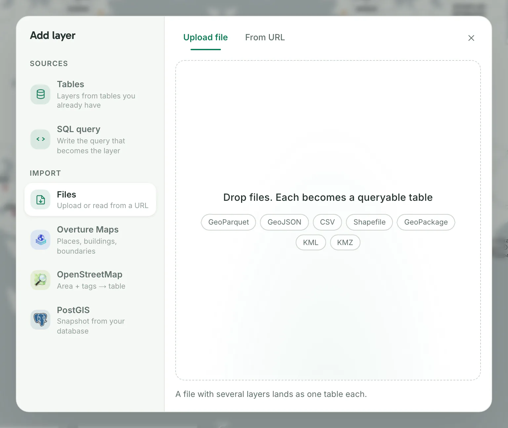
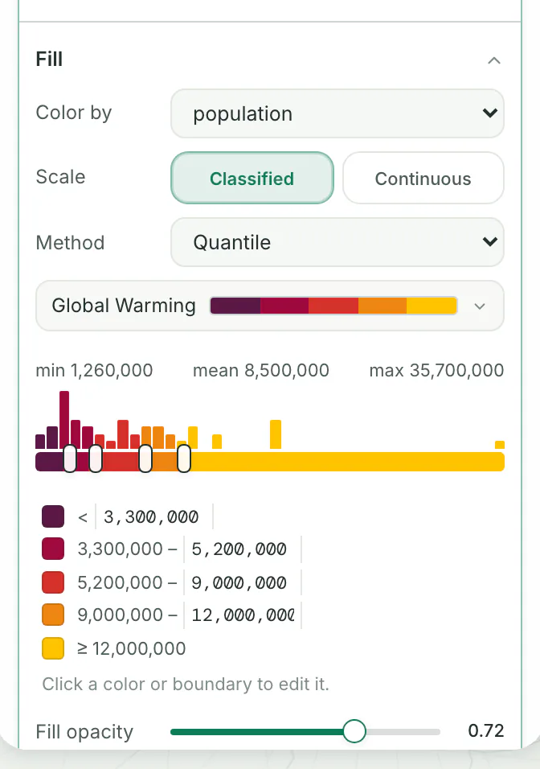
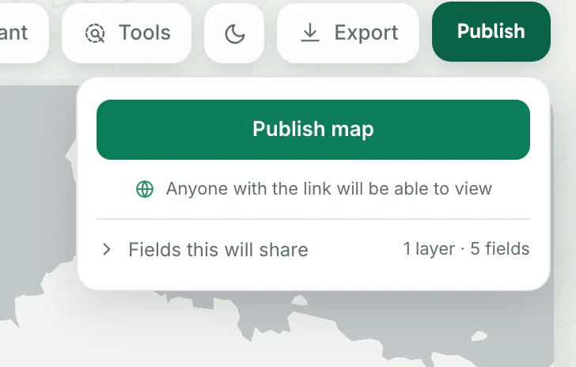

- **Time:** about 10 minutes.
- **You need:** a running Dezfil and an account on it. If you have neither, follow [Install](install.md) first.
- **Data:** 48 cities from Natural Earth (public domain) with the columns `name`, `country`, `population`, `latitude` and `longitude`. Any CSV with latitude and longitude columns works the same way.

## 1. Save the cities

Copy the cities below into a new text file and save it as `world-cities.csv`.

```csv title="world-cities.csv"
name,country,population,latitude,longitude
Tokyo,Japan,35676000,35.687,139.7495
New York,United States of America,19040000,40.7519,-73.982
Mexico City,Mexico,19028000,19.4444,-99.1329
Mumbai,India,18978000,19.0189,72.855
São Paulo,Brazil,18845000,-23.5567,-46.627
Shanghai,China,14987000,31.2184,121.4346
Kolkata,India,14787000,22.4969,88.3227
Dhaka,Bangladesh,12797394,23.725,90.4066
Buenos Aires,Argentina,12795000,-34.6006,-58.3995
Los Angeles,United States of America,12500000,33.9919,-118.1819
Cairo,Egypt,11893000,30.0519,31.248
Beijing,China,11106000,39.9308,116.3863
Manila,Philippines,11100000,14.6061,120.9803
Moscow,Russia,10452000,55.7541,37.6136
Istanbul,Turkey,10061000,41.1069,29.0081
Paris,France,9904000,48.8686,2.3314
Seoul,South Korea,9796000,37.5683,126.9978
Lagos,Nigeria,9466000,6.4452,3.3896
Jakarta,Indonesia,9125000,-6.1725,106.8275
Chicago,United States of America,8990000,41.8319,-87.752
London,United Kingdom,8567000,51.5019,-0.1187
Lima,Peru,8012000,-12.0461,-77.052
Tehran,Iran,7873000,35.6739,51.4224
Kinshasa,Congo (Kinshasa),7843000,-4.3278,15.313
Bogota,Colombia,7772000,4.5984,-74.0853
Bangkok,Thailand,6704000,13.7519,100.5147
Santiago,Chile,5720000,-33.4481,-70.669
Madrid,Spain,5567000,40.402,-3.6853
Toronto,Canada,5213000,43.7019,-79.422
Singapore,Singapore,5183700,1.295,103.8539
Luanda,Angola,5172900,-8.8363,13.2325
Sydney,Australia,4630000,-33.9181,151.1832
Riyadh,Saudi Arabia,4465000,24.6428,46.7708
Hanoi,Vietnam,4378000,21.0353,105.8481
Melbourne,Australia,4170000,-37.8181,144.9731
Johannesburg,South Africa,3435000,-26.1681,28.0281
Berlin,Germany,3406000,52.5238,13.3996
Rome,Italy,3339000,41.8979,12.4813
Athens,Greece,3242000,37.9853,23.7314
Casablanca,Morocco,3181000,33.6019,-7.6183
Addis Ababa,Ethiopia,3100000,9.0353,38.6981
Nairobi,Kenya,3010000,-1.2814,36.8147
Caracas,Venezuela,2985000,10.5029,-66.919
Dakar,Senegal,2604000,14.7178,-17.4751
Tashkent,Uzbekistan,2184000,41.3136,69.293
Havana,Cuba,2174000,23.1339,-82.3661
Auckland,New Zealand,1377200,-36.8481,174.763
Stockholm,Sweden,1264000,59.3527,18.0954
```

## 2. Sign in

Open your Dezfil address, such as <http://localhost:3000>, and sign in with your **Email** and **Password**. If you just created the first account, you are already signed in.

You should see **Home**, which greets you by your first name.

## 3. Create a map

On Home, click **New map**.

You should see the map builder with an empty map named **Untitled map**. To rename it, click **Untitled map** in the bar at the top, replace the name with `World cities` and press Enter.

## 4. Add the cities

1. In the **Layers** tab of the builder, click **Add layer**. The **Add layer** dialog opens on **Files**, with **Upload file** selected.
2. Drop `world-cities.csv` on the box that reads **Drop files. Each becomes a queryable table**, or click the box and choose the file.



Dezfil uploads the file and stores it as a table. It reads the `latitude` and `longitude` columns as each row's position, so every city becomes a point. Then it adds the table to your map as a layer, closes the dialog and zooms to the cities.

You should see 48 points on the map, a layer card named **world_cities** with **48 features**, and for a few seconds the notice **Added world_cities to this map**.

> [!NOTE]
> If the coordinate columns of your own file have other names and its rows do not become points, see [Troubleshooting](#troubleshooting).

## 5. Color the cities by population

The new layer's style panel is open under its card. If it is closed, click **world_cities**.

1. Find the **Fill** section.
2. Set **Color by** to **population**.



Dezfil sorts the cities into five classes with about the same number of cities in each (**Quantile**), and gives each class a color from the palette.

You should see the points change color, and the legend in the corner of the map list the five classes with their population ranges.

Every change saves as you make it. **Undo** at the top of the page takes the last one back. To change the look:

- Click the palette to pick another one.
- Click **Continuous** for a smooth color ramp instead of classes.
- Click a class color or boundary in the panel to edit it.

## 6. Publish the map

1. Click **Publish** at the top right.
2. Click **Publish map**.



You should see **Published** with the map's link, **Copy link** and **Open**. If your browser allows it, Dezfil also copies the link for you. Anyone with the link can view the map, without an account.

Click **Open** to see the map as its readers do. To stop sharing it, open the panel again and click **Unpublish**.

## Troubleshooting

**The dialog stays open and says "imported as a table: no geometry for a layer".** Dezfil found no coordinate columns it recognizes. Fix it one of two ways:

- Rename the columns to `latitude` and `longitude`, then upload the file again.
- Open **Data** in the side menu and open the dataset. Click **Set geometry** and pick **Coordinate pair**. Choose your columns under **Longitude · x** and **Latitude · y**, then click **Apply**. Add the dataset to your map from **Add layer** › **Tables**.

## What you learned

- **Uploading data:** a CSV with latitude and longitude columns becomes points as it uploads.
- **Datasets:** every file you upload is also a dataset, listed under **Data**, that you can query with SQL.
- **Layers and styling:** a layer is a dataset drawn on a map. **Color by** turns one of its columns into colors, and the legend shows what each color means.
- **Publishing:** a published map has a link that anyone can open.

## Next steps

- Start from a finished map instead: [Templates](../use/templates.md).
- Query the cities: open **SQL** in the side menu, type `SELECT name, population FROM world_cities ORDER BY population DESC` and click **Run query**.
- Build maps from a script or an AI agent: [How the API works](../api/http-api.md) and [Connect an AI agent](../api/mcp.md).
