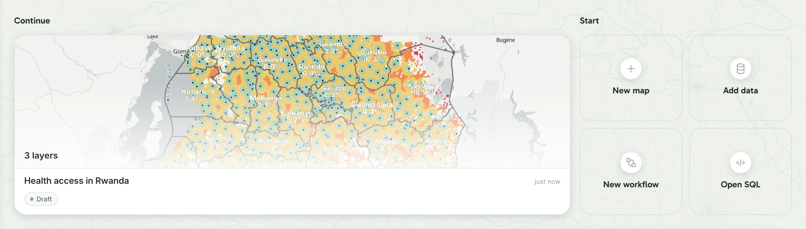
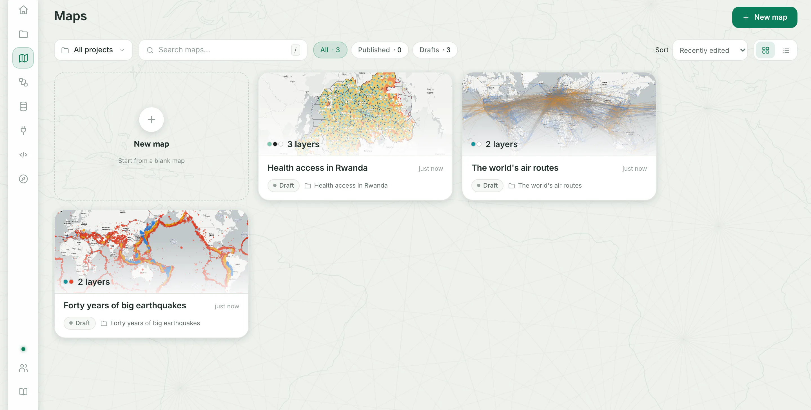
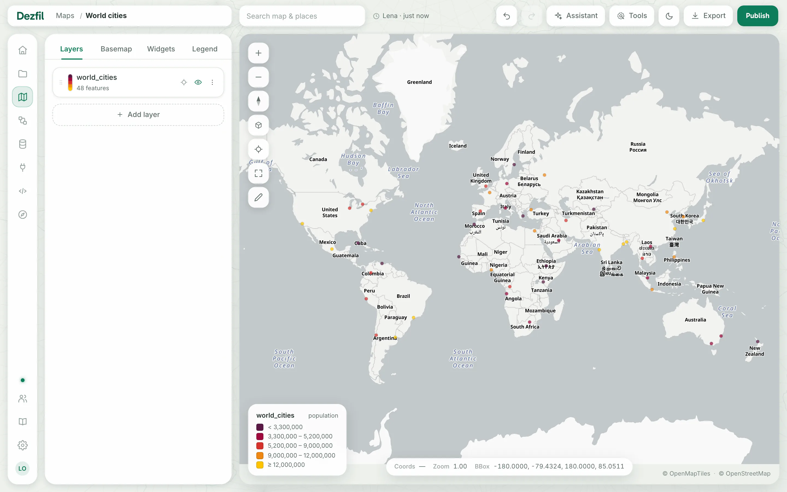
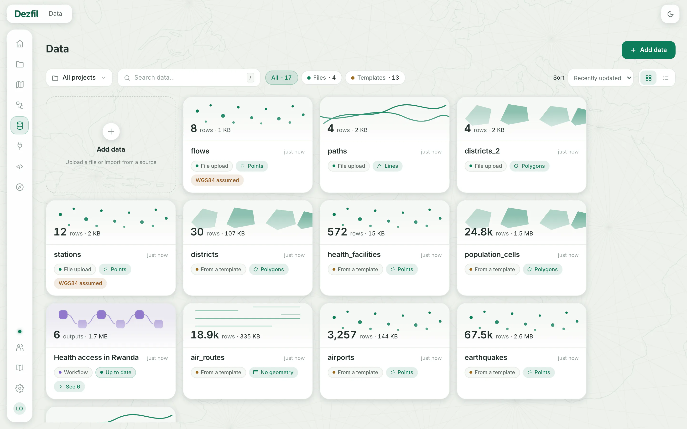
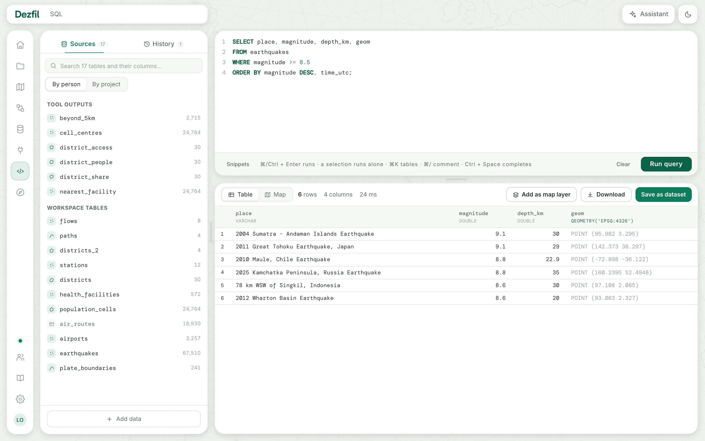
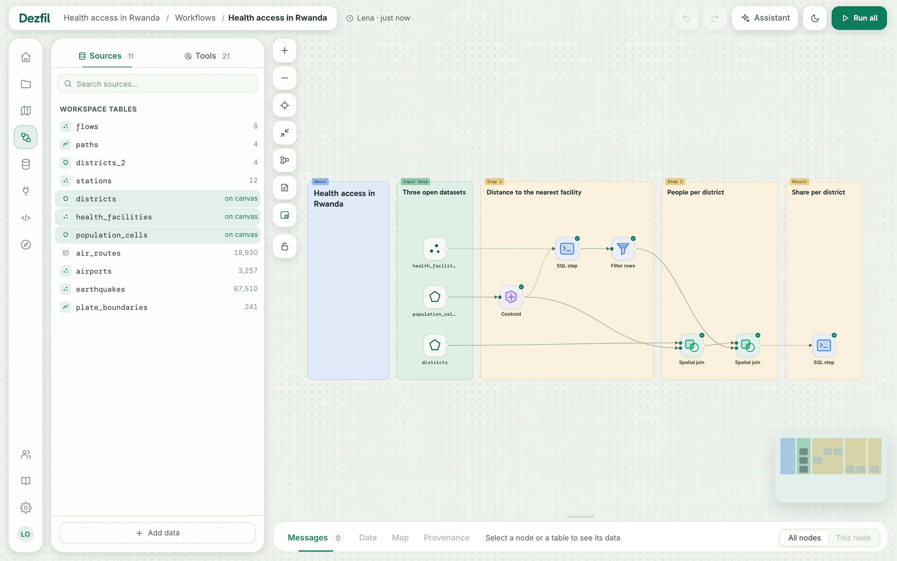
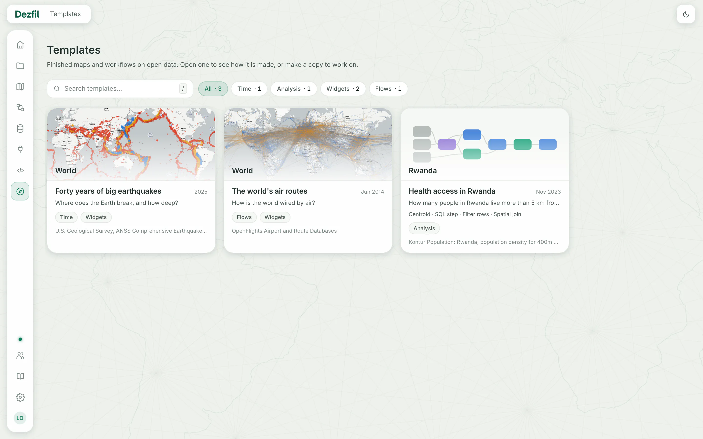

Dezfil is a web app for maps made from your own data: import it, query it with SQL, style it on a map and share the map as a link.

You run it yourself, as one container on your computer or a server.

## Home

Home brings back your last map or workflow under **Continue**, and starts new work with **New map**, **Add data**, **New workflow** and **Open SQL**. [Your first map](first-map.md) begins here.

## Maps

**Maps** shows every map you can open, each as a card with its picture. Search them, show only **Published** or **Drafts**, or click **New map**.

## The map builder

In the builder you add datasets or SQL queries as layers and style each one, then set the **Basemap**, **Widgets** and **Legend**. [Your first map](first-map.md) builds this map step by step.

**Publish** gives the map a link that anyone can open without an account, and **Embed** gives the code that puts it in a web page.

## Data

**Data** holds your datasets, from files such as CSV, GeoJSON or Shapefiles, a link, Overture Maps, OpenStreetMap or PostGIS. Open one to see its rows and its map.

## SQL

The **SQL** workspace queries your datasets in DuckDB's SQL, spatial functions included, and shows the result as a **Table** or on a **Map**.

Keep a result with **Save as dataset**, **Download** or **Add as map layer**. See [Query with SQL](../use/sql.md).

## Workflows

A workflow chains tools, such as **Filter rows** and **Spatial join**, and each node writes a new dataset. Click **Run all** to repeat the chain when the data changes. See [Workflows](../use/workflows.md).

The colored boxes are notes, for comments beside the nodes. Their text shows when you zoom in.

## Templates

**Templates** holds finished maps and workflow examples on open data. Open one to see how it is made, or **Make a copy** of your own. See [Templates](../use/templates.md).

## Also in the app

- **Projects:** a project groups maps, workflows and datasets, and shares them with people as viewers or editors.
- **Connections:** your saved PostGIS databases, whose tables you import as datasets.
- **Assistant:** a chat pane on the map, SQL and workflow pages that reads your data and makes changes when you ask. It runs on an Anthropic or OpenAI key set on the server. See [The assistant](../use/assistant.md).
- **Settings:** your account, your API tokens and your look. Admins also set how the instance behaves there. See [Your settings](../use/settings.md) and [Configuration](../self-host/configuration.md).

## How it runs

- **One container:** the image holds the web app, the API and the query engine, DuckDB with its spatial extension. It serves on port 3000. [Install](install.md) starts it with Docker, Docker Compose or from source.
- **One data folder:** everything Dezfil stores lives in one folder, `/data` in the container. Datasets are GeoParquet files; maps, workflows, accounts and settings sit in one SQLite file. To back up, stop Dezfil and copy the folder. If you set the encryption key `DEZFIL_SECRET_KEY` yourself, keep it too: see [Back up and restore](../self-host/backup-and-restore.md#full-backup-and-restore).
- **Accounts:** the first person to finish setup is the admin, who adds the others under **Users**. Your maps, datasets and workflows stay private until a project shares them or you publish a map.
- **What leaves the instance:** maps load the built-in basemaps from OpenFreeMap, in each viewer's browser and in the map pictures the server draws, and the server reads the template catalogue from GitHub. Imports, the address finder, travel times and the assistant reach outside only when you use or set them up. See [What leaves the instance](../self-host/what-leaves-the-instance.md).
- **Scripts and AI agents:** every action in the app is a call to the HTTP API, described in [the API description](../api/openapi.json). An AI agent connects over MCP at `/api/mcp`, with a token from **Settings** › **API & MCP**. See [Connect an AI agent](../api/mcp.md).
- **Licence:** Dezfil is released under the Apache License 2.0.

## Next steps

- [Install](install.md): run Dezfil on your computer or a server.
- [Your first map](first-map.md): from a CSV file to a shared map in about ten minutes.
- [Templates](../use/templates.md): start from a finished map or workflow example.
