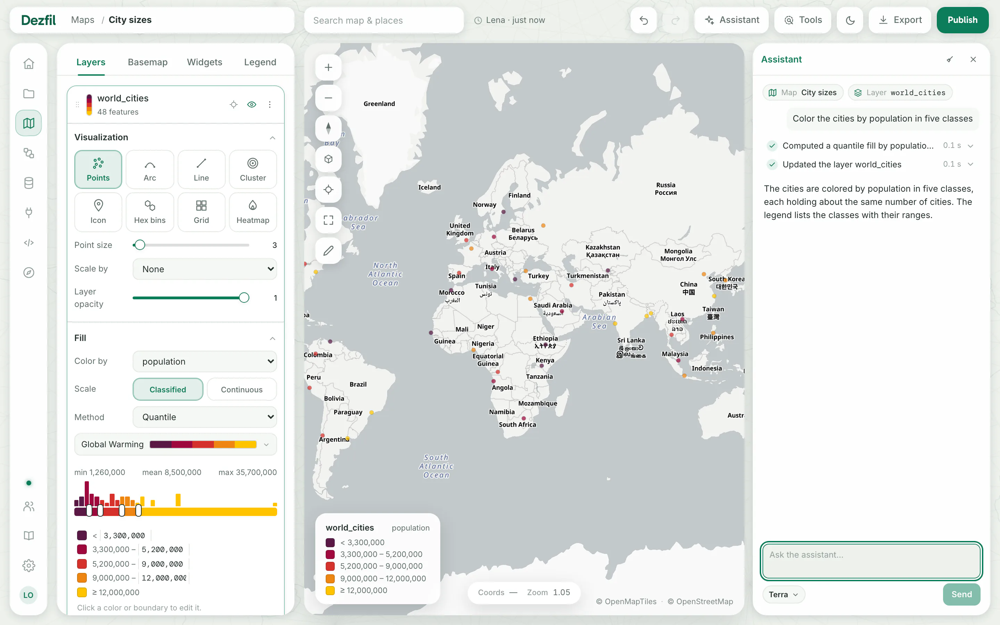
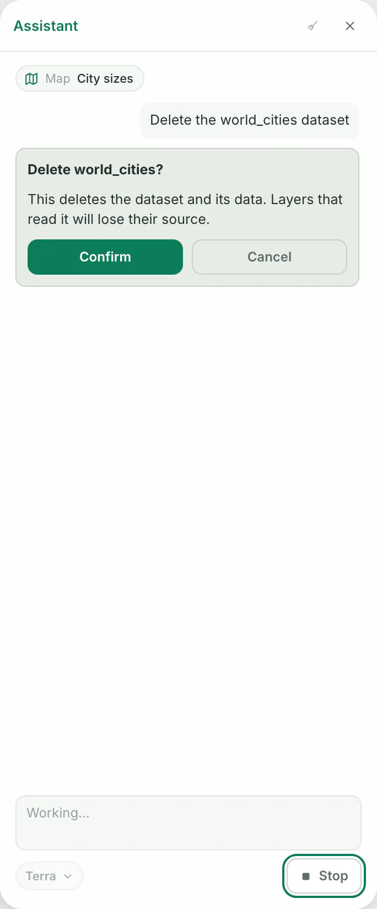
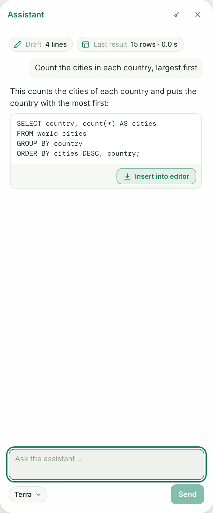
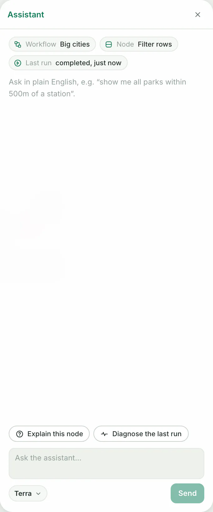

- **You need:** an instance with the assistant turned on, which takes a provider key from whoever runs it. [Set up the assistant](../self-host/assistant.md) shows how.
- **Example data:** the `world_cities` dataset and the map from [Your first map](../start/first-map.md).

## Open the assistant

1. Open a map, the **SQL** page or a workflow.
2. Click **Assistant** in the bar at the top. On a narrow window the button shows only its sparkle icon. You should see the **Assistant** pane on the right, and at its bottom a box that reads **Ask the assistant…**.

Chips under the pane's title show what your next message is about:

- On a map: the **Map** and the selected **Layer**.
- On the SQL page: your **Draft** and the **Last result**, or **Last run** after an error.
- On a workflow: the **Workflow**, the selected **Node** and the **Last run**.

The assistant acts with your account, so it can open and change only what you can.

## Change a map

1. On the map, click the card of the layer you want to talk about, in the **Layers** tab. You should see a **Layer** chip with the layer's name.
2. Type what you want, such as `Color the cities by population in five classes`, and press Enter or click **Send**. You should see a line for each action the assistant takes, then its reply, and the map with the changes.

While it works, the box reads **Working…** and **Send** turns into **Stop**.

An action's line shows a spinner, then a check mark when it is done or a cross when it is not.

Changes from one message form one step in the map's history, so **Undo** in the top bar takes them back together. An edit of your own in between starts a new step.

### What it checked

After a message that changed the map, the assistant takes a picture of the map and looks at it. The line reads **Checked the map.**, followed by what the model saw.

Click the small picture to open **The image the model was given**. Whoever runs your instance can turn this automatic check off; you can still ask the assistant to look at the map.

### What it did

Click an action's line to see the SQL it ran, or the values it used, and the operation's name.

When an action makes a file, a button downloads it, such as **Download the PNG** for a map image or **Download the GeoJSON file** for a layer's data.

## Confirm or cancel an action

Before some actions, the assistant stops and shows a card. The card names the action and its target, and says what follows from it.

To delete a dataset, for example, the card says "This deletes the dataset and its data. Layers that read it will lose their source."

1. Read the card.
2. Click **Confirm** to let the action run, or **Cancel** to leave it undone. You should see the card go and the assistant carry on with the rest of its reply.

While a card waits, you cannot type in the box. Click **Stop** to end the whole request instead.

**Undo** in the top bar takes back only changes to a map. A dataset the assistant deleted, for example, stays deleted. To try a card without changing anything, click **Cancel**.

The assistant asks before it:

| Area | Actions |
|---|---|
| Maps and layers | publishes or unpublishes a map, deletes a map or a layer, makes someone else a map's owner |
| Data | deletes a dataset, clears a dataset's generated geometry, deletes a PostGIS connection or a custom palette |
| Workflows | runs a whole workflow or a node with the nodes that depend on it, deletes a workflow, removes a node, makes someone else a workflow's owner |
| Projects | deletes or leaves a project, gives a person a role or removes them, makes someone else the owner |
| Templates | downloads or copies a template, removes the downloaded templates |
| Your account | changes your password, creates or revokes an API token |
| Admin tasks | invites, changes or deletes a user, issues a sign-in link, changes instance settings, tests a service or a part of the server, changes the basemap library, clears cached service answers, reads how the data folder is used, revokes a deactivated owner's published link |

## Write SQL with the assistant

1. Open **SQL** in the side menu. You should see the SQL editor.
2. Click **Assistant**. You should see the **Draft** chip with the number of lines in the editor.
3. Ask for a query, such as `Count the cities in each country, largest first`. You should see the query in a block in the reply, with **Insert into editor** under it.
4. Click **Insert into editor**. You should see the query in the editor, selected, and the button reads **In the editor**.
5. Click **Run selection**: inserting never runs the query, and while it stays selected the button runs only it. You should see its rows.

If you edited your draft after you asked, the query goes below your draft instead of replacing it, and the block says so. Either way, one undo in the editor takes the insert back.

With each message, the assistant gets your draft, the text you selected, and the last run's SQL with its row count and columns, or its error. To see the data itself, it can run read-only queries of its own.

To fix a failed query, ask while the **Last run** chip shows the error, such as `Why does this fail?`, then insert the corrected query.

On the SQL page the assistant only reads. To have it change a map or a dataset, ask on the map.

## Understand a workflow

1. Open a workflow from **Workflows**. You should see its canvas.
2. Click **Assistant**. You should see the **Workflow** chip.
3. If the pane holds an earlier conversation, click **Clear conversation**, the broom at its top. You should see an empty pane, which the buttons below need.
4. Click a tool's tile on the canvas. You should see the **Node** chip and **Explain this node** above the box. A source or a note gives no **Node** chip.
5. Click **Explain this node**. It sends those words as your message, and the reply explains what the node does.

After a run you start or watch on this page, the **Last run** chip shows its outcome and, in an empty conversation, **Diagnose the last run** appears above the box. An earlier run counts for neither: to ask about a run that failed before you opened the page, run the workflow again here.

On a workflow the assistant only reads: it explains nodes and runs but does not edit or run the workflow. [Workflows](workflows.md) covers building and running one.

## Choose a model

Where your instance offers more than one model, a button under the box names the model in use. Click it and pick a model under **Model**. Where that model has levels, click the button again and pick one under **Effort**.

Your choice holds for every page in this browser tab, and a new tab starts with the instance's default.

While a request runs, the button is locked to the model that answers it. Where your instance offers one model, its id, such as `claude-opus-5`, stands under the pane's title instead. Which models are offered is up to whoever runs the instance: [Set up the assistant](../self-host/assistant.md).

## Stop, clear and come back

- **Stop** ends a request. Actions that finished stay done, as their lines show.
- **Clear conversation**, the broom at the top of the pane, removes the whole conversation. Your next message starts fresh, and the model sees nothing of what came before.
- One conversation follows you between the map, SQL and workflow pages of one browser tab. Closing the tab or signing out ends it.
- A reload ends it too, but brings back an unfinished request.
- The pane opens closed each time you open a page. Click **Assistant** to see the conversation again.

> [!NOTE]
> If you reload or leave the page during a request, the next pane reads how it ended and shows its lines. If it cannot tell yet, click **Check request outcome**.

## Troubleshooting

**The pane says "No model credential is configured.", or names `DEZFIL_AI_PROVIDER`.** The assistant is off on your instance. Whoever runs it turns it on with a provider key: [Set up the assistant](../self-host/assistant.md).

**The pane says "The assistant couldn't be reached."** The page could not ask the server whether the assistant is on. Click **Try again**.

**The pane says "The assistant is at capacity: eight requests are open on this instance."** Wait for one to finish, then send again. If a **Recover pending action** button shows, open that action and confirm or cancel it to free a place.

**A button reads "Recover pending action:" and names an action.** A card from an earlier request still waits, from another page or tab. Click the button to see the card again, then click **Confirm** or **Cancel**.

**The check line says "This instance cannot take a picture of the map."** The server has no browser to draw maps with. Whoever runs it sets one up, or turns the automatic check off, as [Set up the assistant](../self-host/assistant.md#the-check-line-says-this-instance-cannot-take-a-picture-of-the-map) shows.

**Tools closes when you open the assistant.** On a window narrower than 1,860 pixels, **Tools** and the assistant take turns on the map: opening one closes the other. Widen the window to keep both open.

With **Settings** › **Appearance** › **Side menu** set to **Always open**, the window needs 2,016 pixels for both.

**The pane says "The message and its context are too large to send."** Shorten the message, or click **Clear conversation**: each message carries the conversation before it, and on the SQL page your draft.

**The pane says "Page context exceeds 64 KiB of UTF-8 JSON."** On the SQL page, shorten your draft, or select less of it.

## Next steps

- Write and keep queries: [Query with SQL](sql.md).
- Chain tools into steps that run again: [Workflows](workflows.md).
- Use your own AI agent with Dezfil: [Connect an AI agent](../api/mcp.md).
