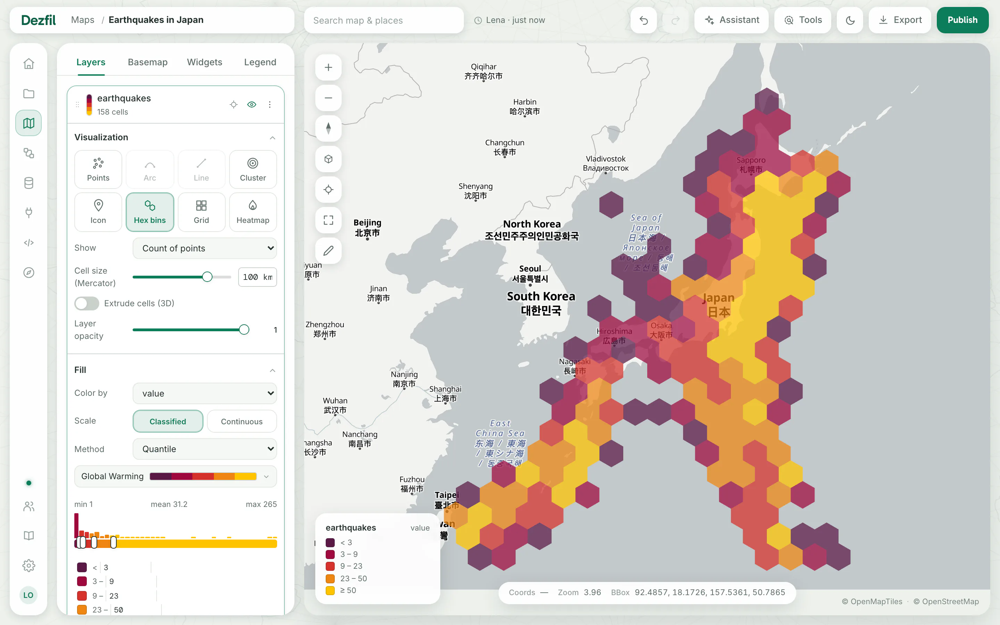
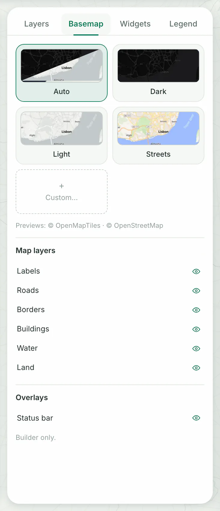
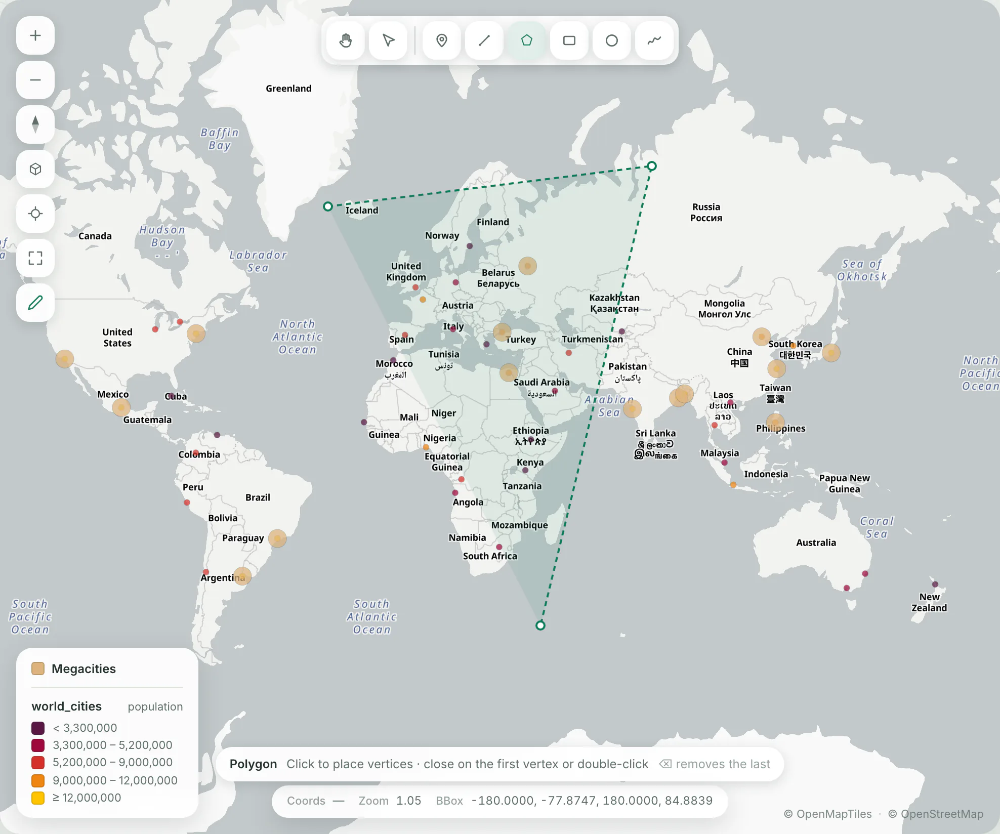

You need a map you can edit and at least one dataset. [Your first map](../start/first-map.md) makes both in about ten minutes.

Every change in the builder saves as you make it. **Undo** at the top of the page takes the last one back.

Widgets, and the tools in the bar at the top, have their own page: [Widgets and tools](widgets-and-tools.md).

## 1. Add a layer

A layer draws one dataset, or the result of one SQL query, on the map. In the **Layers** tab, click **Add layer**, then choose where its data comes from.

::::tabs

:::tab[A dataset]

1. Under **Sources**, click **Tables**.
2. Click a dataset in the list. Type in the search box above it to narrow the list.
3. Click **Add layer**. **Layer name** takes the dataset's name; change it first if you like.

You should see the dialog close and a new card at the top of the layer list, with its style panel open.

:::

:::tab[A SQL query]

1. Under **Sources**, click **SQL query**.
2. Write a query whose result has a geometry column:

   ```sql title="SQL query"
   SELECT * FROM world_cities WHERE population > 10000000
   ```

3. Click **Run preview**, or press ⌘Enter (Ctrl+Enter). You should see the result's rows beside the query.
4. Type a **Layer name** and click **Add layer**. Without a name, the layer is called **Untitled layer**.

You should see the new layer at the top of the list.

:::

:::tab[New data]

1. Under **Import**, click **Files**, **Overture Maps**, **OpenStreetMap** or **PostGIS**.
2. Upload, query or connect as [Import data](import-data.md) describes.

You should see a layer for each table with geometry that the import makes, and a notice such as **Added world_cities to this map**.

:::

::::

## 2. Arrange the layers

The list shows the layers in drawing order: the top card draws over the ones below it. A new layer starts at the top.

| To | Do this |
|---|---|
| Hide or show a layer | Click its eye, **Hide layer** or **Show layer**. A hidden layer also leaves the legend. |
| Zoom to a layer | Click **Zoom to layer**, the target beside the eye. **Fit to data**, in the map's controls, shows every visible layer. |
| Change the order | Drag the card by its grip. With the keyboard, focus the grip, press Space, move with the arrow keys and press Space again. |
| Rename a layer | Double-click its name, type the new one and press Enter. |
| Change its query | **More actions** › **Edit source**. Edit the SQL and click **Update layer**. |
| Copy a layer | **More actions** › **Duplicate** › **Create a copy**. |
| Download its data | **More actions** › **Export data** › **GeoParquet**, **GeoJSON** or **CSV**. |
| Delete a layer | **More actions** › **Delete layer** › **Confirm delete**. Its dataset stays under **Data**. |

## 3. Style a layer

A new layer's style panel is open under its card. For another layer, click its name in the list. Click a section's title to fold it away, and the layer's name again to close the panel.

A new layer starts in one color, the next in your instance's color cycle. The panel's sections depend on the layer's geometry and type:

| Section | What it changes |
|---|---|
| **Visualization** | How the layer draws (the types below), **Point size**, **Layer opacity**, and the height of areas and cells in 3D. |
| **Fill** | The color of points and areas: one **Color**, or **Color by** a column, and **Fill opacity**. |
| **Outline** (**Stroke** on lines) | The color and **Width** of edges and lines, and **Stroke opacity**. |
| **Label** | Text from a column on each feature: **Text**, **Size**, **Color** and a halo. **More** holds the rest. |
| **Filters** | **+ Add filter** keeps the features whose values fall in a range or a list. The layer's query stays as it is. |
| **Tooltip** | The fields shown when you point at a feature. **Automatic (first fields)** shows the first eight. |
| **Pop-up** | The fields shown when you click a feature. |

[Your first map](../start/first-map.md) walks through **Color by**, with its classes and palettes.

To size points by a number column, set **Scale by** under **Point size** to it. Then type the smallest and largest size in pixels.

### Visualization types

| Type | What it draws | What the layer needs |
|---|---|---|
| **Points**, **Path**, **Polygons** or **Features** | Each feature as it is. The tile takes its name from the layer's geometry. | Any geometry |
| **Arc** | A curve from an origin to a destination | Two geometry columns, or two longitude and latitude column pairs |
| **Line** | A straight line from an origin to a destination | The same as **Arc** |
| **Cluster** | Nearby points merged into bubbles | Points |
| **Icon** | A symbol at each point | Points |
| **Hex bins** | Points counted, summed or averaged in hexagons | Points |
| **Grid** | The same, in squares | Points |
| **Heatmap** | Where points are dense, as a smooth surface | Points |

To bin points into hexagons:

1. In **Visualization**, click **Hex bins**. You should see colored hexagons in place of the points, and the card count cells instead of features.
2. Set **Show** to **Count of points**, or to **Sum**, **Average**, **Minimum** or **Maximum** of a number column. You should see the colors follow the new values.
3. Change **Cell size (Mercator)** for bigger or smaller cells.
4. To raise the cells, turn on **Extrude cells (3D)** and choose **Height by**. Then tilt the map with **Pitch**. You should see the cells stand at their heights.



> [!NOTE]
> A type the layer cannot use is grayed out. Point at it to read why, or see [Troubleshooting](#troubleshooting).

## 4. Choose the basemap

1. Click the **Basemap** tab.
2. Click a style.

You should see the map redraw on that style. The choice belongs to this map.



| Style | What it is |
|---|---|
| **Auto** | Follows the app's theme: the dark map in dark mode, the light map in light mode. New maps start on it unless an admin chose another. |
| **Dark**, **Light**, **Streets** | Fixed styles that keep their look in either theme. |
| **Satellite** | Aerial imagery, shown only where an admin set it up. |
| Cards after these | Styles an admin added to the instance's library. |
| **Custom…** | A MapLibre style of your own, by its address. |

To use a style of your own:

1. Click **Custom…**.
2. Paste the address of the style's JSON in **Style URL**, and give it a **Name (optional)**.
3. Click **Check**. You should see the style's name, its number of layers and sources, and its credit.
4. Click **Use this style**. You should see the map redraw, and the style's card selected.

To go back, click **Remove** on that card. The map returns to the style chosen underneath.

Under **Map layers**, an eye hides or shows the basemap's **Labels**, **Roads**, **Borders**, **Buildings**, **Water** or **Land**. The published map keeps the choice.

**Status bar**, under **Overlays**, hides the coordinates and zoom bar at the bottom of the map. It changes only your own view, in this browser.

## 5. Edit the legend

The legend lists each visible layer, with what its colors and sizes mean. It starts in the bottom left corner of a new map, unless an admin chose another.

On the map:

- Drag the legend to move it to another corner.
- Click a class label to rename it in place. Press Enter to keep it, Escape to cancel. An empty label returns to the automatic text.
- Click a layer's title or a column's name to edit it in the **Legend** tab.

To edit every text in one place:

1. Click the **Legend** tab. You should see a row for each layer.
2. Type a title in the first field. Left empty, the legend shows the layer's name.
3. Rename the column in the **variable** field, or click its eye to hide the name. You should see the legend change as you type.
4. Type over any class label in the fields below.
5. Clear a layer's checkbox to leave it out of the legend. You should see it vanish from the map's legend.

**Reset to automatic** clears a layer's own texts, and **Corner** moves the legend to another corner.

Drag the rows to change the legend's order. **Reset order** returns it to the order of the layer list.

## 6. Draw on the map

1. Click **Draw**, the pencil last in the map's controls. You should see the draw tools at the top of the map, and **Pick a tool. This session’s shapes become one layer** at the bottom.
2. Click a tool and draw, as the table below shows. You should see each shape stay as you finish it, and the first one add a layer named **Sketch** to the list.
3. Click **Finish drawing**, the pencil again, or press Escape until the tools close. You should see a notice such as **Sketch saved · 3 shapes · world_cities_sketch**.



| Tool | How to draw |
|---|---|
| **Draw points** | Click. Each click saves a point. |
| **Draw a line** | Click to place each vertex. Double-click or press Enter to finish. |
| **Draw a polygon** | Click to place each vertex. Click the first vertex again, or double-click, to close it. |
| **Draw a rectangle** | Drag from one corner to the other. |
| **Draw a circle** | Drag out from the center. The radius is measured in meters on the ground. |
| **Draw freehand** | Press and drag. Letting go closes the shape. |
| **Move the map** | Drag to pan and scroll to zoom, without drawing. |

While you draw a line or a polygon, Backspace removes the last vertex. While the tools are open, ⌘Z (Ctrl+Z) removes the latest shape.

Each drawing session makes its own layer: **Sketch**, then **Sketch 2**, and so on. Its shapes are kept in a dataset named after the map, such as `world_cities_sketch`.

To change a shape, click it on the map with **Select a drawn shape**, or while no tool is picked. You should see its name at the bottom of the map, with **Delete** and **Done**.

- **Delete**, or Backspace, removes the shape.
- On a polygon or a freehand shape, drag a handle to move a vertex.
- **Done** lets go of the shape.

**More actions** › **Delete layer + dataset…** on a sketch layer deletes its shapes too.

## Troubleshooting

**A visualization type is grayed out.** Point at it to read why. **Heatmap**, **Hex bins**, **Grid**, **Cluster** and **Icon** need points, and **Arc** and **Line** need an origin and a destination.

**Arc, Line, Icon and Cluster are grayed out on a big layer.** Its card reads **tiled**, so it draws as map tiles. Filter it or bin it first.

**Bands of color cross the whole map with Hex bins or Grid.** A cell on the 180° meridian, in the Pacific, is drawn the long way round the world. Leave the points next to that meridian out of the layer's query with **More actions** › **Edit source**.

**Add layer stays grayed out after you pick a dataset.** The dataset has no geometry column, as the dialog says. If the dialog offers **Set geometry**, click it to give the dataset one on its page, then add it again.

**A layer's card says error.** Click the card: its style panel says what went wrong. Fix the query with **More actions** › **Edit source**.

**Custom… is grayed out.** Your instance takes only the styles its library offers, and the panel says so. An admin can add a style, or allow others, in **Settings** › **Libraries** › **Basemaps**.

**Check cannot reach the style.** The panel says why and offers **Use anyway**. Readers' browsers load the style themselves, so it may still work for them.

**The map shows the default style instead of Satellite.** The instance has no satellite imagery. An admin sets it up in **Settings** › **Libraries** › **Satellite imagery**.

**The Map layers eyes are grayed out.** They work on vector styles only, not on **Satellite**. Your choices are kept for the next vector style.

**Draw is grayed out.** The map is still loading. It turns on once the map has drawn.

## Next steps

- Share the map with people, or publish it as a link: [Share and publish](share-and-publish.md).
- Add widgets, or run a tool on a layer: [Widgets and tools](widgets-and-tools.md).
- Bring in more data: [Import data](import-data.md).
