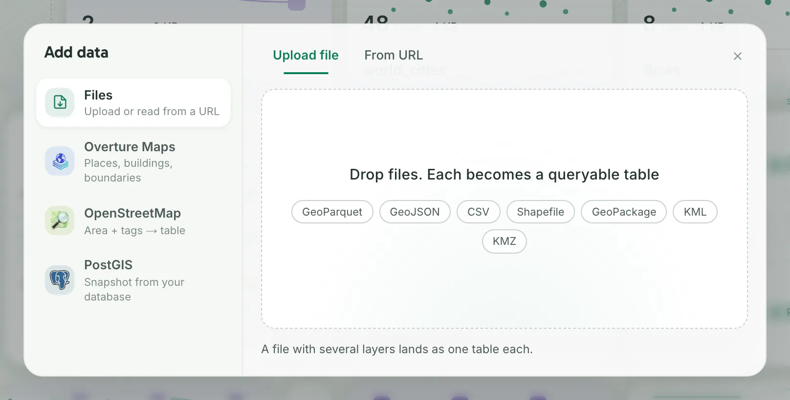

Everything you import becomes a dataset: a table you can put on a map, query with SQL or use in a workflow.

Open **Add data** on the **Data** page or on **Home**. In a map, **Add layer** has the same sources under **Import** and adds the result as a layer: see [Build a map](build-a-map.md).

## Upload files

1. Open **Data** in the side menu and click **Add data**. You should see the dialog on **Files**, with **Upload file** selected.
2. Drop one or more files on the box that reads **Drop files. Each becomes a queryable table**, or click the box and choose them. You should see each file's name, its upload progress and its place in the batch, such as (1 of 3).

When every file has landed, the dialog closes, unless a CSV first stops at [Column matching](#csv-columns). You should see a notice such as **world_cities is ready.** and a card for each new dataset.

Dropping files anywhere on the **Data** page also starts an upload.

Each dataset is named after its file, in lower case with underscores: `World Cities.csv` becomes `world_cities`. If that name is taken, Dezfil adds `_2`, `_3` and so on.

A file that fails stays in the dialog with the reason; the rest of the batch still uploads.

When the **Data** page shows one project, what you import joins it. See [Share and publish](share-and-publish.md).

## Formats

| Format | File | What you get |
|---|---|---|
| GeoParquet | `.parquet`, `.geoparquet` | One dataset |
| GeoJSON | `.geojson`, `.json` | One dataset |
| CSV | `.csv` | One dataset, with geometry from its columns (see [CSV columns](#csv-columns)) |
| Shapefile | `.zip` holding the `.shp` and its side files (`.shx`, `.dbf`, `.prj`) | One dataset per `.shp` in the zip, named `<file>_<layer>` when there are several |
| GeoPackage | `.gpkg` | One dataset per layer that has geometry, named `<file>_<layer>` when there are several; the notice names the layers skipped |
| KML | `.kml`, `.kmz` | As for GeoPackage; a `.kmz` is read from its `doc.kml`, or else its first `.kml` |

A file that declares another coordinate system is reprojected to WGS 84 as it imports.

## CSV columns

Dezfil first looks for geometry in a CSV's column names, in this order, whatever their case:

| Columns | What Dezfil makes |
|---|---|
| A text column named `wkt`, `geometry` or `geom` | Geometry read from its WKT text, in place of that column |
| `longitude` and `latitude`, `lon` and `lat`, `lng` and `lat`, or `long` and `lat`, both numeric | A point for each row; the two columns stay |
| Numeric pairs that share a start, such as `pickup_lon` and `pickup_lat` | A point for each row from the origin pair, or from the only pair; the columns stay |

Then it reads the values. A column whose sampled values all read as WKT, GeoJSON geometry, WKB hex or H3 cells becomes the geometry, and the original columns stay.

With no sure match, **Add data** stops at **Column matching**. Columns named `x` and `y` stop there, and so does a named pair with a longitude beyond ±180 or a latitude beyond ±90:

1. Under **Format**, check or change the kind of geometry: **Coordinate pair**, **WKT text**, **GeoJSON**, **WKB hex** or **H3 cell**.
2. Choose the column. For a pair, choose the columns under **Longitude · x** and **Latitude · y**.
3. If the numbers are not in degrees, pick their system under **Projection**, which starts at WGS 84.
4. Check the preview and the count of rows that read, then click **Confirm**. You should see the dataset on the **Data** page with its geometry.

To keep the file as a table without geometry, click **Cancel**. In a map, **Add layer** skips this step and keeps the table without geometry.

## Import from a link

1. In **Add data**, click **Files**, then **From URL**.
2. Paste the file's address into **File URL**. **Table name** fills in from the file name; change it if you want.
3. Click **Import as table**. You should see the dialog close and a notice that the dataset is ready.

The address starts with `https://`, `http://`, `s3://`, `gs://` or `az://` and ends in a file name whose extension is in [Formats](#formats).

Public `s3://` and `gs://` files need no credentials. Private buckets and `az://` addresses need credentials on the server: see [Data and services](../self-host/configuration/services.md).

Dezfil keeps a copy of the file, not a live link: see [Refresh an import](#refresh-an-import).

> [!NOTE]
> If the fields are grayed out with "Only admins can import from links on this instance.", an admin can change **Who may import from links** in **Settings** › **Data & services**.

## Import from Overture Maps

1. In **Add data**, click **Overture Maps**.
2. Under **Query Area**, choose the area. **BBox** › **Rectangle** starts with a box on the map: drag its corners, and pan or zoom to move it.
3. Under **Theme**, click **Places**, **Buildings**, **Transportation**, **Divisions**, **Base · land & water** or **Addresses**.
4. Click **Run Query** to look first. You should see the features on the map beside the form, and their count.
5. Click **Import as table**. You should see the dialog close and the new dataset on the **Data** page.

Other areas: **Current View**, a polygon you **Draw** or pick with **Select from Layer**, or a **Country**, **State** or **City** under **Boundaries**.

**Places** take a **Category**, such as **Restaurants**, and **Divisions** a **Level**, such as **States & regions**.

Under **Area rule**, **Entirely inside** keeps only features fully inside the area; **Touching the area** also keeps those crossing its edge.

## Import from OpenStreetMap

1. In **Add data**, click **OpenStreetMap**.
2. Under **Query Area**, choose a **Polygon** or **BBox** area, as for Overture Maps.
3. Under **Tags**, click the × on `amenity=restaurant`, the tag the form starts with.
4. Under **Quick queries**, click **Buildings**, **Roads**, **Amenities** or **Landuse**, or type a tag such as `shop=bakery` in **Tags** and press Enter. Every tag listed is imported together.
5. Click **Import as table**. You should see the dialog close and up to three new datasets.

The result is split by geometry into `<name>_points`, `<name>_lines` and `<name>_polygons`, keeping those that hold features. Each has a `name` column, a column for each tag key you asked for, such as `amenity`, and all its tags in a `tags` column.

To write the request yourself, click **Edit query**, change the Overpass QL and click **Use query**. In it, `{{bbox}}` stands for your area.

## Connect a PostGIS database

Dezfil imports a PostGIS table as a snapshot: a copy you can refresh later. It only reads from your database.

1. In **Add data**, click **PostGIS**. Without a saved connection, you should see **Connect a PostGIS database**.
2. Fill in **Connection name**. Then fill in **Host**, **Port**, **Database**, **Username** and **Password**, or paste a [`postgres://` address](../api/http-api.md#connections) into **Paste a connection URL** to fill them. Clear **Require SSL for this connection** for a database without SSL.
3. Click **Test & save connection**. You should see **Connected** with the PostgreSQL and PostGIS versions, then the database's tables.
4. Click a table. You should see a **Preview** of up to 5 rows from the database.
5. Click **Import**. You should see **Imported as** with the dataset's name, and **Open table** and **Import another**.

Next time, **PostGIS** opens on your **Saved connections**: click one to see its tables, or click **New connection**.

Use a database user that may only read. The password is stored encrypted and never shown again.

To import part of a table, open **Filter or row limit** first. **Filter** takes a `WHERE` condition that runs on the database, such as `population > 100000`; **Row limit** caps the rows.

What people in your projects see of a connection: [Share and publish](share-and-publish.md#what-viewers-and-editors-can-do).

> [!NOTE]
> If **New connection** or the form is grayed out with "Only admins can add database connections on this instance.", an admin can change **Who may add database connections** in **Settings** › **Data & services**.

## Refresh an import

Datasets imported from a link, Overture Maps, OpenStreetMap or PostGIS can be fetched again from their source.

1. Open the dataset from the **Data** page.
2. Click the refresh button, **Re-run the stored import**, at the top. You should see **updated just now** beside the dataset's name.

An Overture Maps dataset refreshes from its own release; for a newer one, click **Update to latest release** under its name.

A connection's page under **Connections** in the side menu refreshes its snapshots one by one or with **Refresh all**.

An upload cannot be refreshed: upload the new version, which lands beside the old one as a new dataset.

## Troubleshooting

**The import says "Unsupported file type".** Dezfil reads the format from the file's extension. Convert the file to one of the [formats](#formats).

**A CSV lands without points.** Open the dataset, click **Set geometry**, fill in the fields as for **Column matching**, and click **Apply**. Or rename the columns as in [CSV columns](#csv-columns) and upload again.

**Features land in the wrong place, and the dataset says WGS84 assumed.** The file declared no coordinate system, so Dezfil read it as WGS 84. On the dataset page, click **WGS84 assumed**, choose the file's projection and click **Apply**.

**The dataset says Header looks broken.** Its column names look like data: the header row is missing or was never split. Fix the first row and upload again.

**The import says the file or area is too large.** Choose a smaller file or area, or ask an admin to raise the limit the message names, in **Settings** › **Limits** › **Imports** or with the variable it names. [Limits](../api/limits.md) lists them all.

**"The requested address is not reachable from this server".** Dezfil blocks loopback, private-network, link-local and metadata addresses, such as a database on your own network. An operator allows a host with `DEZFIL_EGRESS_ALLOWLIST`: see [Data and services](../self-host/configuration/services.md).

**Overture Maps Places with a Category answer "An unexpected server error occurred."** Choose **Any category**, then keep the category you want in **SQL**, such as `WHERE category = 'restaurant'`.

**The connection says "PostGIS not installed: only attribute tables can be imported".** Its tables import without geometry. Install the PostGIS extension in the database, then click **Test now** on the connection's page.

## Next steps

- Put a dataset on a map: [Build a map](build-a-map.md), or **Add to a map** on the dataset page.
- Share datasets through a project: [Share and publish](share-and-publish.md).
- Query your datasets: [Query with SQL](sql.md).
- Import from a script or an AI agent: the [API quickstart](../api/quickstart.md) and [Connect an AI agent](../api/mcp.md).
