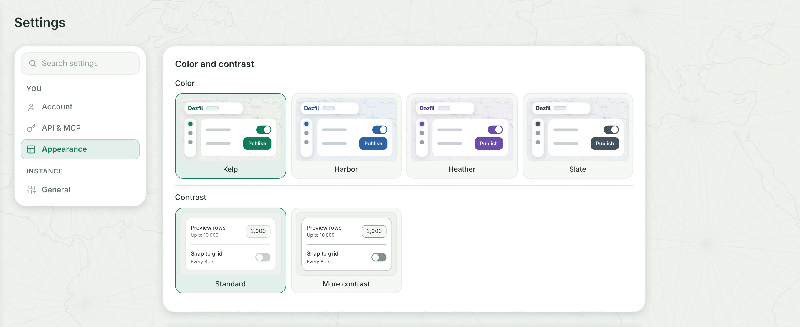
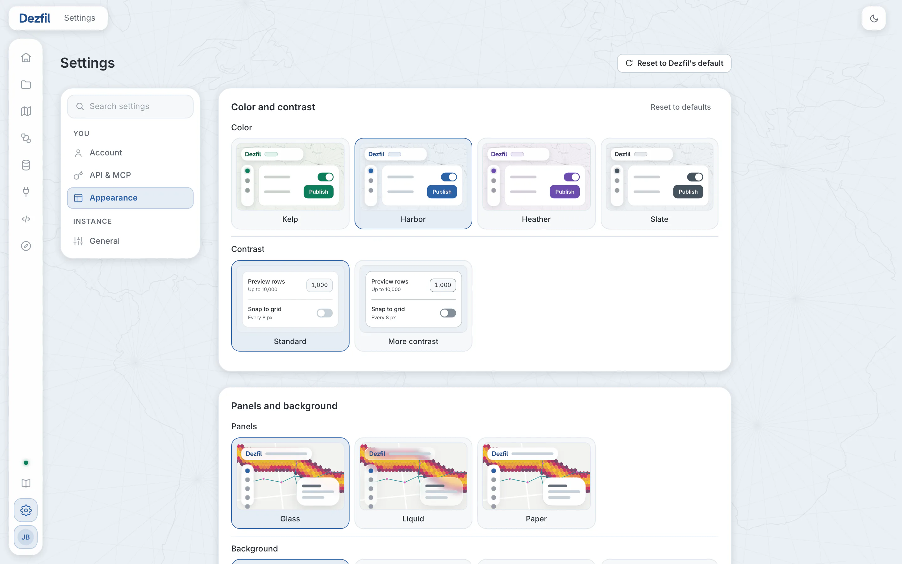
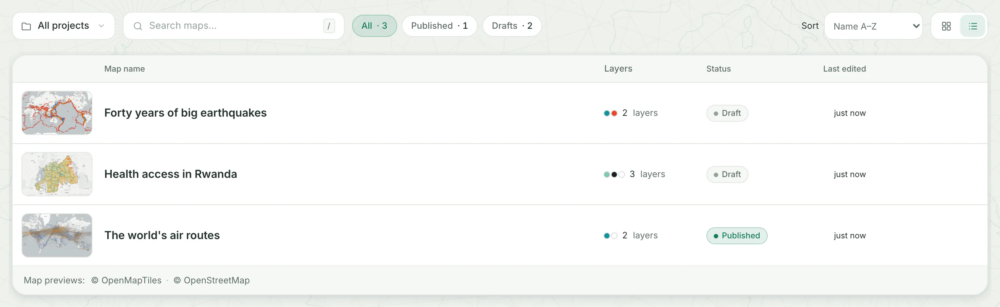
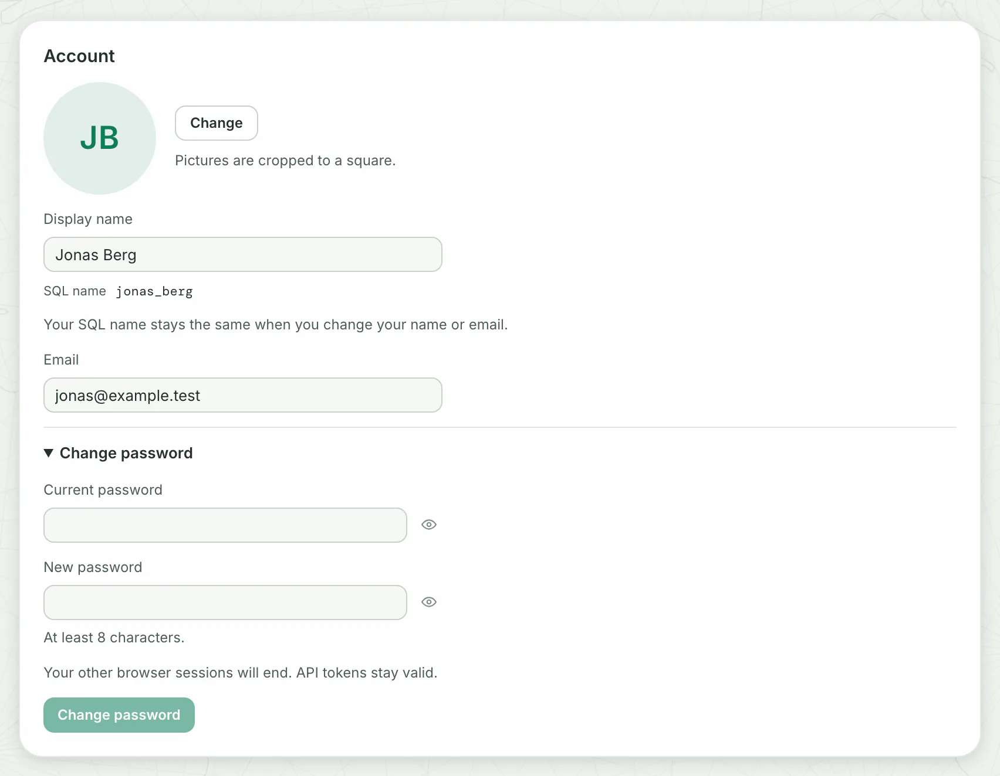

Your own settings sit under **You** in **Settings**: **Account**, **API & MCP** and **Appearance**. Your look and your list choices change only what you see.

## Change the look

1. Click **Settings** at the foot of the side menu, then **Appearance**.
2. In the **Color** row, click **Harbor**.

You should see the whole workspace take the new color at once, and **Saved** beside the row for a moment.

There is no Save button: each pick is kept the moment you click it. Every row works the same way, and its first choice is Dezfil's default.

| Card | Row | Choices | What it changes |
|---|---|---|---|
| **Color and contrast** | **Color** | **Kelp**, **Harbor**, **Heather**, **Slate** | The interface's tint: accents, primary buttons, active marks, focus and the background's ink. Never a data color. |
| | **Contrast** | **Standard**, **More contrast** | Borders, dividers and quieter text. **More contrast** makes them stronger in both themes. |
| **Panels and background** | **Panels** | **Glass**, **Liquid**, **Paper** | How cards and panels are drawn: frosted glass, liquid glass with a light on its rim, or opaque paper with no blur. |
| | **Background** | **Atlantic chart**, **Plain**, **Graticule**, **Hex lattice** | The texture behind the workspace and in the header bar. **Plain** has none. |
| **Text** | **Typeface** | **Inter**, **System** | The face of everything you read: Inter, or your computer's own. Identifiers and values keep the mono face. |
| **Layout** | **Corners** | **Rounded**, **Soft** | The rounded edges of cards, fields, buttons and panels. **Soft** is tighter. |
| | **Side menu** | **Opens on hover**, **Always open**, **Icons only** | How the side menu opens: when your pointer or focus rests on it, always open with labels, or icons only. |

To go back, click **Reset to defaults** at the top right of a card. It shows while one of the card's rows differs from the default, and returns those rows.

**Reset to Dezfil's default**, at the right of the **Settings** heading, returns every pick at once. It shows while any pick differs from the default.

Either reset turns into **Undo** for six seconds, and stays while your pointer or focus rests on it.

People who open your published maps see Dezfil's default look, whatever you picked.

## Switch between light and dark

Click the theme button at the right of the top bar: a moon while the page is light, a sun while it is dark.

You should see the page switch at once. Dezfil starts light. In the builder, a map on the **Auto** basemap follows the theme.

To find the button from Settings, type `dark` in **Search settings** and choose **Light or dark**. You should see the theme button light up for a moment.

> [!NOTE]
> Switching the theme while your own published map is open in the builder switches the theme its readers see as well.

## Lay out and sort your lists

**Maps**, **Data**, **Workflows** and **Projects** each have a **Sort** menu and two buttons, **Grid view** and **List view**, in the bar above the list.

1. Open **Maps** in the side menu.
2. Click **List view**. You should see your maps as rows, with the columns **Map name**, **Layers**, **Status** and **Last edited**.
3. Under **Sort**, choose **Name A–Z**. You should see the rows in alphabetical order.

Each screen keeps its own layout and sort. The next time you open it, it opens the same way.

| Screen | Sort choices | Starts with |
|---|---|---|
| **Maps** | **Recently edited**, **Recently created**, **Name A–Z** | **Grid view**, **Recently edited** |
| **Workflows** | **Recently edited**, **Recently created**, **Name A–Z** | **Grid view**, **Recently edited** |
| **Data** | **Recently updated**, **Name A–Z**, **Row count**, **Size** | **Grid view**, **Recently updated** |
| **Projects** | **Recently updated**, **Name A–Z**, **Largest** | **Grid view**, **Recently updated** |

## Change your name or email

1. Click your initials or name at the foot of the side menu. **Settings** opens on **Account**.
2. Change **Display name** (up to 80 characters) or **Email**. **Save** and **Cancel** appear while a field differs from what is saved.
3. For a new email, also type your password in **Current password to change email**.
4. Click **Save**. You should see **Saved** beside the field.

You sign in with the new email from then on.

Your **SQL name** stays as it is. Other people's queries name your datasets with it, as [Query with SQL](sql.md#other-peoples-datasets) shows.

## Change your password

1. On **Account**, click **Change password**.
2. Fill in **Current password** and **New password**. The line under **New password** names the fewest characters it needs: 8, unless your admin set more.
3. Click **Change password**. You should see **Password changed**.

Your other browser sessions end, so those browsers ask you to sign in again. Your API tokens keep working.

## The other tabs

- **API & MCP** holds **API / MCP tokens** and the **MCP server** card. [Connect an AI agent](../api/mcp.md) shows how to use them.
- Under **Instance**, **General** shows the instance's name and its sign-in settings. Only admins change them; [Configuration](../self-host/configuration.md) covers the tabs an admin sees.
- **Search settings**, at the top of the column, finds any setting by its name.

## Where your choices are kept

| Choice | Where you change it | Kept |
|---|---|---|
| Your look | **Settings** › **Appearance** | With your account, in every browser you sign in on |
| Layout and sort of a list | **Maps**, **Data**, **Workflows**, **Projects** | With your account, for each screen |
| SQL source grouping | **By person** or **By project** in **SQL**, as [Query with SQL](sql.md#other-peoples-datasets) shows | With your account |
| Light or dark | The theme button in the top bar | In this browser only |
| Name, email and password | **Settings** › **Account** | With your account |

## Troubleshooting

**"Enter your current password to change your email." shows under the field.** You changed **Email**. Type your password in **Current password to change email**, then click **Save**.

**The card says "An account already uses this email address."** Another account has that email. Choose another one, or ask an admin.

**The card says "Enter your current password."** The current password you typed is wrong. Type it again.

**The card says "Too many wrong current passwords. Try again later."** After 5 wrong current passwords in 15 minutes, or the count your admin set, Dezfil pauses your password and email changes. Wait up to 15 minutes.

**The card asks for more characters, or says "This password is too common. Choose a different one."** Choose a longer password that is less common.

**Another browser shows another theme or look.** The theme belongs to each browser: click the theme button there. A page already open takes your new look when you reload it.

**You forgot your password.** Ask an admin to open your account in **Users** and click **Reset password**. They get a sign-in link to pass to you.

## Next steps

- Query your datasets and other people's: [Query with SQL](sql.md).
- Read and change the same preferences from a script with `GET /api/settings` and `PATCH /api/settings`: [How the API works](../api/http-api.md).
