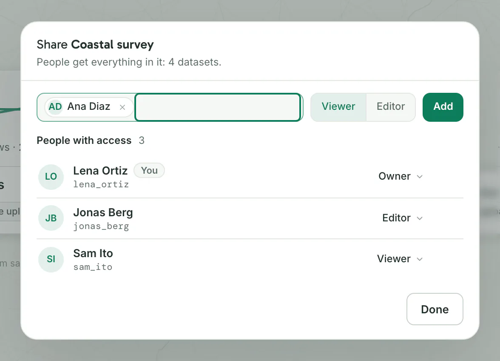

| To | Use | Who sees it |
|---|---|---|
| Work with people who have an account on your Dezfil | A project and its **Share** dialog | The people you add, as **Viewer** or **Editor** |
| Show a finished map to anyone | **Publish** in the map builder | Anyone with the link, without an account |
| Show a map inside another web page | **Embed** in the publish panel | The visitors of that page |
| Put a map in a report or slides | **Export** › **Image** in the map builder | Whoever gets the PNG file |

## Put your work in a project

A project holds maps, workflows and datasets. The people you share it with reach everything filed in it. Work in no project stays private to its owner.

1. Open **Projects** in the side menu and click **New project**.
2. Type a **Name** of up to 120 characters and click **Create**. You should see the new project's card.
3. Open the project and click **Add to project**. The dialog has a tab each for **Maps**, **Workflows** and **Data**.
4. Tick what you want and click the button that counts it, such as **Add 3 items**. You should see the items in the project's sections.

A map or workflow sits in one project at most, so adding it moves it out of the project it was in. A dataset can be in several projects.

A map brings the datasets it draws and the workflows that make them; a workflow brings the datasets it reads and writes. Only your own work is offered.

From a card in **Maps**, **Workflows** or **Data**, **Add to a project** files that one item, with what it brings, and can create a project too. A filed map or workflow offers **Move to another project**.

## Share a project with people

Only the project's owner shares it.

1. On the project's page, click **Share**. On **Projects**, a card's **Share project** button opens the same dialog.
2. In **Add people by name or email**, type part of their name or their whole email address, then pick the person from the list.
3. Choose **Viewer** or **Editor** and click **Add**.

You should see the person under **People with access**, and a line such as **Added Ana Diaz as Viewer.** at the bottom of the dialog.

The project appears on their **Projects** page, and its card shows your first name and their role.

You can add only people with an active account on your Dezfil. An admin invites people on the **Users** page.

## What Viewers and Editors can do

A role covers everything filed in the project: every map, workflow and dataset in it, whoever owns it.

| Action | Viewer | Editor |
|---|---|---|
| Open the project's maps, workflows and datasets | Yes. Maps open read-only, with zoom, north and fit | Yes. Maps open in the builder |
| Query the project's datasets in **SQL**, download data, export the project | Yes | Yes |
| Duplicate a map or workflow | Yes. The copy is yours, in no project | Yes. The copy is yours, filed in the project |
| Change maps and workflows: layers, styles, legend, widgets, steps | No | Yes |
| Run workflows | No | Yes |
| Add your own maps, workflows and datasets to the project | No | Yes |

Some acts stay with one person, whatever the roles:

- Only a dataset's owner changes it, refreshes it or deletes it.
- Only a map's owner publishes it, changes its publication, unpublishes it or deletes it.
- Only the project's owner renames, shares, hands over or deletes it. They can also edit every map and workflow in it.

Being an admin gives you no access to anyone's work.

Database connections are never shared. A dataset that refreshes from your PostGIS connection stays yours to refresh, and the **Share** dialog names each one.

In **SQL**, you write someone else's dataset with their SQL name in front, such as `lena_ortiz.stations`. The **Share** dialog shows each person's SQL name.

## Change roles, remove people and hand a project over

The project's owner does all of this in the **Share** dialog:

- **Change a role:** click the person's role and pick **Viewer** or **Editor**.
- **Remove someone:** point at their row and click the cross. **Undo** at the bottom of the dialog puts them back. Nothing they own is deleted.
- **Hand the project over:** click **Owner** on your row and pick **Transfer ownership…**, or pick **Make owner** in a member's role menu. Choose the new owner and click **Transfer ownership**.

After a hand-over you stay as an Editor, and every map, workflow and dataset keeps its owner. Only an active member can receive a project.

To leave a project shared with you, click **⋯** on its page, pick **Leave project** and confirm. What you made there stays yours and stays in the project.

To delete a project you own, click **⋯**, pick **Delete project** and confirm. Only the project goes: its maps and workflows stay, in no project.

## Publish a map

1. Open the map in the builder and click **Publish** at the top right.
2. Click **Fields this will share** to see what each layer sends to readers. Click **Edit** on a layer to tick fields on or off.
3. Click **Publish map**.

You should see **Published**, the link, **Copy link** and **Open**. Dezfil also copies the link when your browser allows it. **Preview** in the top bar opens the published page.

Readers see the map as it is, and your later edits reach them on their next load. A hidden layer's features are not published, but a widget on that layer still shows readers its numbers. Which widgets go out: [Widgets and tools](widgets-and-tools.md#widgets-on-a-published-map).

By default, a layer shares the fields its style, filters and widgets need, marked **needed to render**, plus those its hover and click pop-ups show. **Reset to automatic** restores the default. On a published map, **Fields this will share** reads **Shared fields**.

A layer drawn as cells, such as hex bins, shares only each cell's computed values.


To change what readers can do, click **Published** at the top right:

- **Opens in**: **Light** or **Dark**. A map opens in the mode you published it in, and follows when you switch the app's theme in its builder.
- **Readers can**: untick **3D tilt**, **Fit to data**, **Light / dark**, **Basemap picker** or **Cursor coordinates**. All are on at first, and **Zoom** and **North** always stay.

These changes keep the same link and reach readers on their next load.

To stop sharing, click **Published**, then **Unpublish**. The link stops working at once, and readers see **Map not found**. Publishing the map again gives it a new link, opening in the mode you are working in, with every control on.

On the **Maps** page, a card's **Publish map** publishes a draft, and **Copy share link** copies a published map's link.

> [!NOTE]
> Other people in the project see that a map is published, but not its link.

## Embed a map in a web page

1. Publish the map, then click **Embed** at the bottom of the publish panel.
2. Click **Copy code**. You should see **Code copied**.
3. Paste the code into the HTML of your page.

```html title="Embed code"
<iframe src="https://<YOUR_DEZFIL_ADDRESS>/v/<LINK_ID>?embed=1" width="100%" height="480" style="border:0" title="World cities" loading="lazy" allowfullscreen></iframe>
```

- `?embed=1` shows the embedded view: the map with zoom, north and, while it is ticked, **Fit to data**, without 3D tilt, the theme switch, the basemap picker or the coordinates.
- `width="100%"` fills the width of the page's column. Change `height="480"` to suit your page.
- The embed is the published map: your edits reach it, and **Unpublish** takes it down too.

> [!NOTE]
> An admin decides which sites may show embedded maps, in **Settings** › **Publishing** › **Embedding on other sites**: **Any site**, **Listed sites** or **Off**. Under **Off**, the panel has no **Embed** button and embeds already on other sites stop showing the map.

## Export an image

1. In the map builder, click **Export** and pick **Image**. A dialog opens with a preview of your current view.
2. Frame the picture: drag the preview to move the map, scroll to zoom.
3. Pick a **Shape** and a **Size**. To add a title, type it in **Title**.
4. Click **Download PNG**. You should see **Preparing image…**, then your browser saves a PNG named after the map.


| Option | What you choose |
|---|---|
| **Shape** | **16:9**, **4:3**, **1:1**, or **Custom**: drag the preview's bottom or right edge |
| **Size** | 1280, 1920 or 2560 pixels wide. A size that would be over 4,096 pixels tall is grayed out |
| **Title** | Up to 200 characters, in size **XS**, **S**, **M** or **L** |
| **Legend** | **Include the legend**, and its size. It sits in the corner the map's legend uses |
| **Widgets** | On a map with widgets, a switch for each one, and their size |
| **Basemap** | The size of the basemap's labels and symbols, and **Labels**, **Roads**, **Borders**, **Buildings**, **Water** and **Land** on or off, except on an imagery basemap |
| **Credit** | The size and corner of the map data credit. Every image carries it |

The options change only the image, never the map. A new dialog opens at 1920 pixels wide and **4:3**; an admin changes that in **Settings** › **Publishing** › **Image export**.

To download a layer's data rather than a picture, see [Build a map](build-a-map.md#2-arrange-the-layers).

## Export a project

1. On the project's page, click **Export project**. On **Projects**, a card's **Export bundle** button opens the same dialog.
2. Under **Contents**, tick what to export and click **Next**.
3. Under **Review**, choose the **Dataset format**: **GeoParquet**, **GeoJSON** or **CSV**.
4. Click **Download**. You should see your browser save a zip file named after the project.

The zip holds the datasets in that format and the maps and workflows as JSON, without their published links. The datasets upload to any Dezfil as files; Dezfil has no import for the maps and workflows.

## Troubleshooting

**Publish map is grayed out.** The panel says why under the button, such as "Only admins can publish maps on this instance." An admin changes this in **Settings** › **Publishing** › **Who may publish**.

**Publishing says "You can view this but cannot make this change."** The map belongs to someone else in the project. Ask its owner to publish it.

**The person you want to add is not found: "No account with that name." or "No account with that email."** Type part of their name, or their whole email address. They need an active account: someone an admin invited has one once they have used their sign-in link and set a password.

**The embedded map does not show on your site.** Embedding is **Off**, or your site is not listed. Ask an admin for **Any site**, or to add your site's address under **Listed sites**, such as `https://intranet.example.com`.

**Image is grayed out in the Export menu.** The view is too close to frame at the map's width. Zoom out a little, widen the map or use fullscreen.

**The builder says "This item has changed. Reload it before trying again."** The map changed after you opened it, for example by an Editor. Click **Reload**, then **Copy SQL** to keep SQL you have not saved, then **Reload** again.

## Next steps

- Build the map you want to share: [Build a map](build-a-map.md).
- Publish from a script or an AI agent: [How the API works](../api/http-api.md) and [Connect an AI agent](../api/mcp.md).
- Every setting behind publishing and image export: [Configuration](../self-host/configuration.md).
