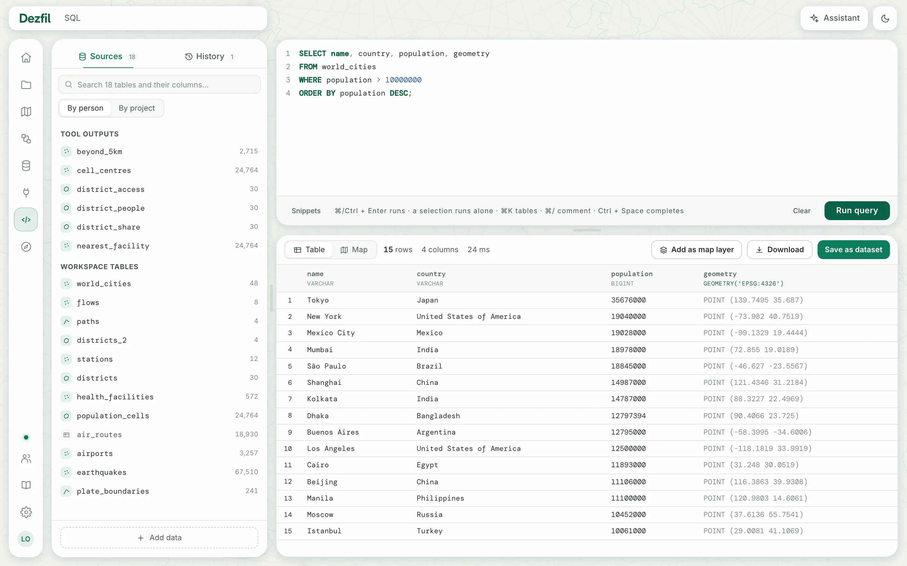
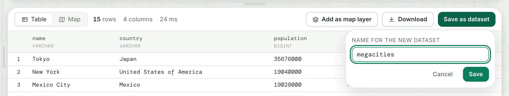
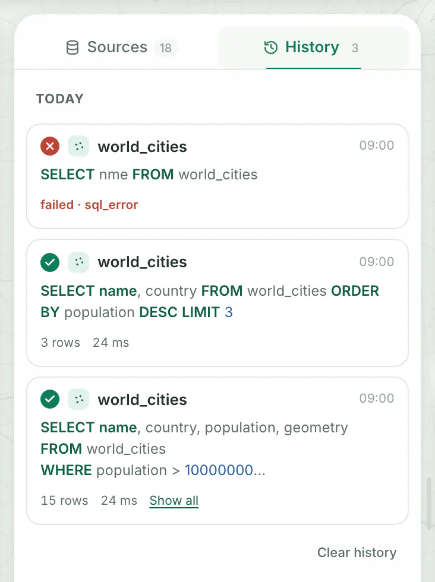

- **You need:** an account on a running Dezfil and at least one dataset.
- **Example data:** the `world_cities` dataset from [Your first map](../start/first-map.md). Any dataset works the same way.

## 1. Open the SQL workspace

Click **SQL** in the side menu.

You should see your datasets under **Sources** on the left, the editor at the top, and **Nothing to show yet** where the results go.

From **Data**, the **Query in SQL** button on a dataset's card opens the workspace with a query for its first 100 rows, and runs it.

## 2. Look at a dataset

Click **world_cities** in **Sources**.

You should see **Preview** with the dataset's first rows, its row and column counts and its size. Click **Map** to see its features and **Table** to go back.

Hover a row in **Sources** for its two buttons:

- **Open as SQL** puts a query for the dataset's first 100 rows in the editor and runs it.
- **Insert at the cursor** types the dataset's name, in quotes, where your cursor is.

To find a dataset, type in the search box above the list. It matches dataset names and column names. Press ⌘ + K (Ctrl + K on Windows and Linux) to jump there.

## 3. Run a query

1. Click in the editor and type this query:

   ```sql title="SQL"
   SELECT name, country, population, geometry
   FROM world_cities
   WHERE population > 10000000
   ORDER BY population DESC;
   ```

2. Click **Run query**, or press ⌘ + Enter (Ctrl + Enter on Windows and Linux).

You should see 15 cities in a table, Tokyo first. Above the table you see 15 rows, 4 columns and the time the query took.

- `WHERE population > 10000000` keeps the cities with more than ten million people.
- `geometry` is the column that holds each city's point. Keep it in the `SELECT` to see the result on a map.

The workspace runs one read-only `SELECT` at a time, in [DuckDB's SQL](https://duckdb.org/docs/current/sql/introduction.html) with its [spatial functions](https://duckdb.org/docs/current/core_extensions/spatial/functions.html), such as `ST_Buffer` and `ST_Area`. A statement that changes data is refused.

As you type, the editor offers dataset names, column names and spatial functions.

Select part of the text and the button reads **Run selection**: only the selected text runs. While a query runs, the button reads **Cancel**.

Your editor text stays in this browser. When you come back, the line under the editor says **Restored your last draft.**, and **Clear** beside it empties the editor.

## 4. See the result on a map

Click **Map** above the result.

You should see the 15 cities as points on a basemap, with 15 features and the column name `geometry` in the corner. Hover a point to read its other columns.

**Map** is greyed out when the result has no geometry column. Make one with a spatial function, such as `ST_Point(longitude, latitude) AS geometry`.

A large result shows only its first rows, in the table and on the map, and the footer says how many of how many. An admin sets how many rows under **Rows shown in results** in **Settings** › **Limits**.

Click a cell to read its whole value. **Copy** puts it on the clipboard.

## 5. Keep the result

The bar above the result has three ways to keep it. Pick the one you need:

::::tabs

:::tab[Save as dataset]

1. Click **Save as dataset**.
2. Under **Name for the new dataset**, replace `query_result` with `megacities`. If a name holds capitals, spaces or other signs, the panel shows the name it is **stored as**.
3. Click **Save**.



You should see **Saved as** `megacities` under the bar, with the link **open it**. The new dataset appears in **Sources** and in **Data**.

Dezfil runs the whole query again and stores every row, not only the rows on screen. The dataset keeps those rows as they were. To update it, save the query again under a new name.

:::

:::tab[Download]

1. Click **Download**.
2. Click **CSV**, **GeoParquet** or **GeoJSON**.

You should see **Preparing…** on the button. Then your browser saves `query_result.csv`, `query_result.parquet` or `query_result.geojson`.

The file holds every row of the result. **CSV** writes geometry as WKT text. **GeoJSON** needs a geometry column and uses the first one.

:::

:::tab[Add as map layer]

1. Click **Add as map layer**. The **Add to a map** dialog opens.
2. Change **Layer name** if you like. It starts as **Query result**.
3. Click one of your maps, or **New map** to start a blank one.

You should see the map builder with the new layer selected. The layer holds your query, not a copy of its rows.

**Add as map layer** is greyed out when the result has no geometry column.

:::

::::

> [!NOTE]
> All three keep the query behind the result on screen, even after you change the editor's text. Run the query again to keep the new version.

## Run a query again

Click **History** at the top of the pane. Every query you run lands there, newest first and grouped by day, with its rows and time or its error code.

- Click a card to put its query in the editor.
- Click **Run again** to put it in the editor and run it.
- Click **Remove from history** to drop one card, or **Clear history** at the foot to drop them all.



History lives in this browser and keeps your 40 latest different queries. Running the same text again moves its card to the top. A cancelled run stays out.

## Write queries faster

**Snippets**, under the editor, inserts a starting point for a spatial query. It fills in the dataset selected in **Sources** and its geometry column. Anything else stays a placeholder in angle brackets, such as `<areas_table>`.

| Snippet | What it writes |
|---|---|
| **Within a distance** | The rows of the dataset near a point |
| **Points in polygons** | A spatial join of the dataset onto a table of areas |
| **Count by area** | How many rows of the dataset fall in each area |
| **Buffer** | A ring around every row of the dataset |
| **Centroids** | One point per shape of the dataset |

A snippet never runs by itself. It replaces the editor only while the editor is empty or holds an unchanged snippet or **Open as SQL** query. Otherwise it lands below your text.

| Keys | What they do |
|---|---|
| ⌘ + Enter or Ctrl + Enter | Run the query, or only the selected text |
| ⌘ + K or Ctrl + K | Jump to the search box in **Sources** |
| ⌘ + / or Ctrl + / | Comment or uncomment the selected lines |
| Ctrl + Space | Show the names and functions you can type here |

To have a query written for you, click **Assistant** in the header. **Insert into editor** puts its SQL in the editor without running it.

> [!NOTE]
> `ST_DWithin` and `ST_Buffer` measure in the units of the coordinates: degrees for longitude and latitude, as the comments in the **Within a distance** and **Buffer** snippets say.

## Other people's datasets

When someone shares a project with you, its datasets appear in **Sources** under their owner's name and SQL name. In a query you write them as `<sql name>.<dataset>`, such as `ada.roads`. Your own datasets need no prefix.

**By project**, above the list, groups **Sources** by project instead of **By person**. Dezfil remembers the choice for your account. Your own SQL name is in **Settings** › **Account**.

## From a script or an AI agent

Each action in the workspace is an API operation, and an MCP tool for agents:

| In the workspace | HTTP API | MCP tool |
|---|---|---|
| **Sources** | `GET /api/tables` | `list_tables` |
| **Run query** | `POST /api/query` | `run_sql` |
| **Download** | `POST /api/query/export` | `export_sql_result` |
| **Save as dataset** | `POST /api/operations/run` with the operation `sql_step` | `run_operation` |
| **Add as map layer** | `POST /api/maps/{id}/layers` | `create_layer` |

Run a query with an API token, which you make in **Settings** › **API & MCP**:

```sh title="Terminal"
curl -s http://localhost:3000/api/query \
  -H "Authorization: Bearer <YOUR_TOKEN>" \
  -H "Content-Type: application/json" \
  -d '{"sql": "SELECT name, country FROM world_cities ORDER BY population DESC LIMIT 3"}'
```

```json title="Output"
{
  "columns": [
    { "name": "name", "type": "VARCHAR" },
    { "name": "country", "type": "VARCHAR" }
  ],
  "rowCount": 3,
  "preview": [
    { "name": "Tokyo", "country": "Japan" },
    { "name": "New York", "country": "United States of America" },
    { "name": "Mexico City", "country": "Mexico" }
  ],
  "previewTruncated": false,
  "runtimeMs": 5
}
```

- `rowCount` counts every row of the result. `preview` holds the first rows, and `previewTruncated` is `true` when some were left out.
- Geometry comes as WKT text. Add `"geometry": "geojson"` to the request for GeoJSON objects instead.
- `runtimeMs` is how long the query took, so yours differs.

To let an agent call these tools, see [Connect an AI agent](../api/mcp.md).

## Troubleshooting

**The result shows `sql_rejected`.** Dezfil runs one read-only `SELECT` at a time. Remove statements that write, and run several statements one by one: select one and click **Run selection**.

**`sql_rejected` on `read_csv` or another file reader.** A query reads datasets by name, never files by path. Add the file as a dataset with **Add data** at the foot of the pane, then query it by its name.

**The result shows `sql_error` and the editor marks a line.** The message names the problem, such as a column the engine cannot find. Fix the marked place and run again. An unknown dataset name gets this error too: check the name in **Sources**.

**The result shows `query_timeout`.** The query ran past your instance's time limit. Narrow it with `WHERE` or `LIMIT`, or ask an admin to raise **Query time limit** in **Settings** › **Limits**.

**The result shows `query_result_too_large`.** The answer is too big to show, so the workspace offers no way to keep it. Select fewer columns or rows. To download every row anyway, call `POST /api/query/export` from [a script](#from-a-script-or-an-ai-agent).

**Save as dataset says a table with that name already exists.** Dezfil never replaces a dataset when you save. Choose another name.

## Next steps

- Chain queries and tools into steps that run again: [Workflows](workflows.md).
