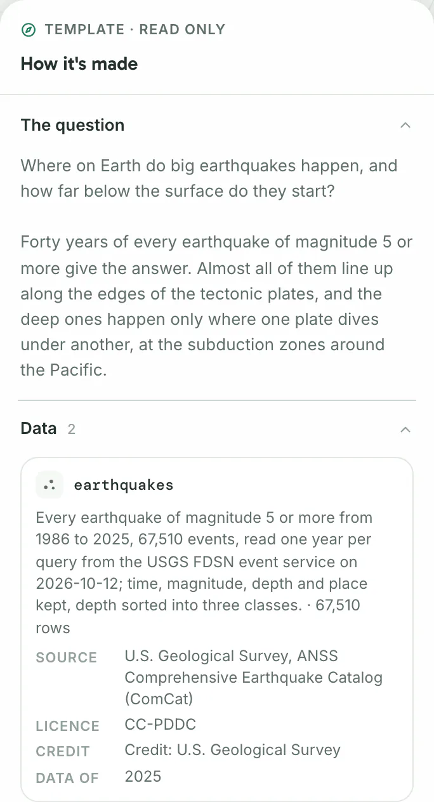
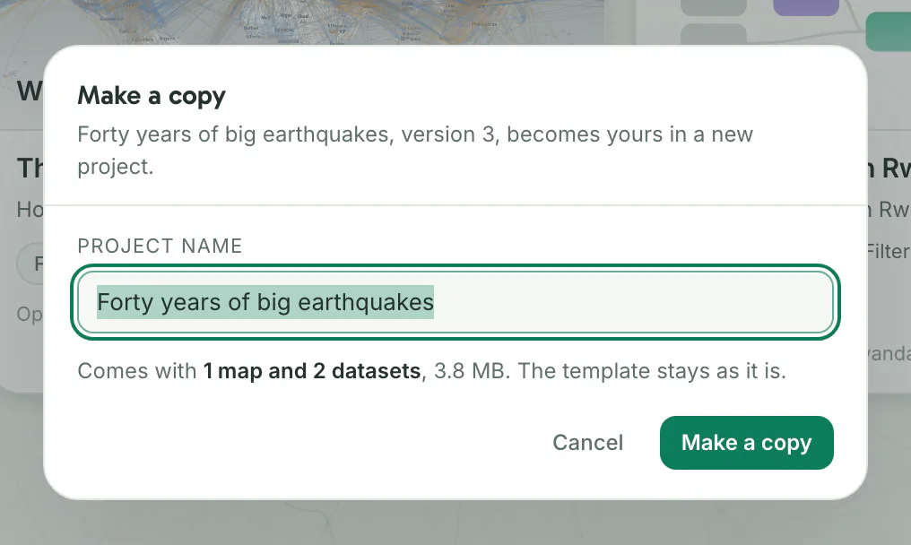

A template is a finished map, or a workflow example with its map, built on open data. Open one to see how it is made, or copy it to make it yours.

Three templates come with Dezfil and work without a network: the maps **Forty years of big earthquakes** and **The world's air routes**, and the workflow example **Health access in Rwanda**.

When your server can reach the template catalogue, it lists more templates from there.

## 1. Find a template

Click **Templates** in the side menu, below **SQL**.

You should see one card per template, the ones that come with Dezfil first. Home shows a few of them too.

| Part of a card | What it tells you |
|---|---|
| Picture | The map, or a workflow example's steps drawn as a graph |
| Place | Where the data is, written on the picture |
| Date | When the data is from |
| Question | What the map or workflow answers |
| Tools | A workflow example's tools, in the order it uses them |
| Tags | Its first two tags |
| Sources | Where the data comes from. Point at the line to see each source's credit and licence. |
| **Downloads … when opened** | Only when your server does not hold the version listed yet: the size of its download |

To narrow the cards:

- Type in **Search templates…**, or press `/` to jump there. The search looks in the title, the question, the place and the sources' names and credits.
- Click a tag, such as **Time** or **Analysis**, to keep the templates that carry it. Each tag counts the templates that match your search, and **All** shows them all.

You should see only the cards that match. When none do, the page reads **No template matches. Clear the search or pick All.**

## 2. Open a template

Click a card, such as **Forty years of big earthquakes**.

You should see the template's map with its legend, and beside it a panel headed **Template · read only** and **How it's made**. You can pan, zoom and play its timeline. Nothing you do here changes the template.

**How it's made** tells the template's story in sections. Click a section's title to open or close it. The first two start open.

| Section | What it holds |
|---|---|
| **The question** | What the template asks, and how its data answers it |
| **Data** | Each dataset: how it was made, its rows, its **Source**, **Licence** and **Credit**, and the date of its data (**Data of**) |
| **Workflow** | A workflow example's steps in order, each with the dataset it makes |
| **Layers and their SQL** | Each layer's SQL, and its style in words |
| **Styling choices** | The choices behind the map's look, one line each |

A workflow example, such as **Health access in Rwanda**, opens on its workflow canvas instead, read only and without a run. **How it's made** stands where the **Sources** and **Tools** pane would be.

A template's address, such as `/templates/earthquakes`, opens it for anyone with an account on your server. Send it to point a colleague at the template.

> [!NOTE]
> A card with a **Downloads … when opened** line holds a template, or a newer version of one, that your server does not have yet. Opening it downloads it first, once. After that it opens at once, for everyone on your server.

## 3. Make a copy

Start on the template's page. On the Templates page, pointing at a card also shows a copy button in its corner, whose hint reads **Make a copy**.

1. Click **Make a copy** at the top right. You should see the **Make a copy** dialog, which names the template and the version it copies.
2. Check **Project name**: it starts as the template's title and holds up to 120 characters. You should see under it what comes with the copy, and its size.
3. Click **Make a copy**. You should see your copy's map in the builder, ready to change. A workflow example's copy opens on its workflow canvas instead.

Your copy is a new project of your own, private to you until you share it. It holds the map, every dataset the template uses and, for a workflow example, the workflow. The template stays as it is.

The project's note, under its name on the project page, says which template and version the copy came from, and on which day.

The copied datasets appear under **Data** as **From a template**. They are yours to query and to put on other maps. Dezfil never refreshes them from the template's sources.

You can copy a template as often as you like. Each copy makes a new project. A dataset whose name you already have takes the next free name, such as `earthquakes_2`.

A workflow example's copy comes with the results the template made. Click a node: its **Last run** reads **copied from the template** until you run it. To make the results again from your copied datasets, click **Run all** and confirm.

## Troubleshooting

**The page says "The template catalogue is turned off, so only the templates on this server show."** An admin turned the catalogue off. The templates that come with Dezfil and the ones already downloaded still open and copy.

To list the others, an admin turns the catalogue on in **Settings** › **Data & services** › **Templates** › **Catalogue**. [Data and services](../self-host/configuration/services.md) lists it with the catalogue's address.

**The page says the template catalogue "did not answer", or gives another reason, then "so only the templates on this server show."** Your server could not read the catalogue, so only the templates it holds show. Open **Templates** again after half a minute to try once more.

If it keeps happening, ask your admin to check the catalogue's address and what the server may reach: [What leaves the instance](../self-host/what-leaves-the-instance.md).

**Opening a template stops with an error while it downloads.** Click **Try again**, or click **Templates** to go back. If it fails again, the error says why. When your server cannot reach the catalogue, the entry above applies.

## Next steps

- Change your copy's map: [Build a map](build-a-map.md).
- Run and change a workflow example's copy: [Workflows](workflows.md).
- Query the copied datasets: [Query with SQL](sql.md).
- Share your copy or publish its map: [Share and publish](share-and-publish.md).
- Start from your own file instead: [Your first map](../start/first-map.md).
