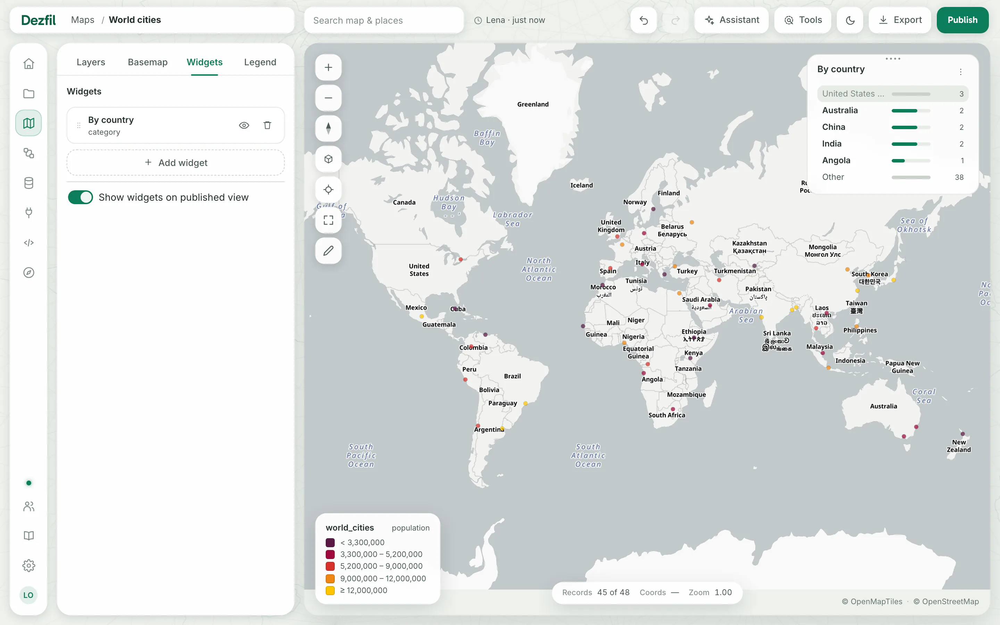
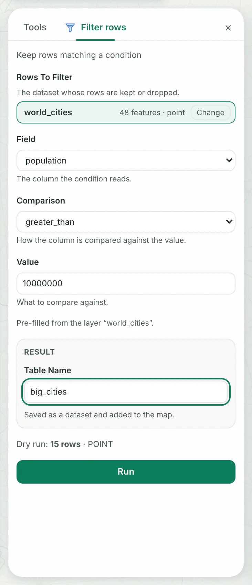

Widgets are cards at the right edge of the map. Each one counts or charts one layer's data, or holds a note, and a click or a drag on a chart filters that layer.

Tools run one analysis step, such as a buffer or a join, on a layer's data. Each run saves a new dataset and, when it has geometry, adds it to the map as a layer.

- **You need:** a map you can edit, with at least one layer. The steps use the World cities map from [Your first map](../start/first-map.md).

## Add a widget

1. In the builder, click the **Widgets** tab. You should see **No widgets yet.**
2. Click **Add widget**. You should see four cards: **Formula**, **Category**, **Histogram** and **Note**.
3. Click **Category**.
4. Set **Group by** to **country**. You should see the title **By country**, and the widget at the right of the map with **United States of America** first.
5. Click **Add widget**. You should see a **By country** row in the tab.

While the editor is open, the widget on the map follows your changes. Nothing is kept until you click **Add widget**, **Add note** or **Save**, and **Cancel** drops the changes.

| Kind | What you set | What it shows |
|---|---|---|
| **Formula** | **Aggregate**: **count** of rows, or **sum**, **avg**, **min** or **max** of a number **Field**. **Unit**, **Format** and **Note** change how the number reads | One number. While another widget filters its layer, the unfiltered number shows under it, after **filtered from** |
| **Category** | **Group by** any column except a time column, and **Rank by** **count**, **sum of…** or **avg of…** a number column, chosen in **Over field** | The top five values, each with a bar, and **Other** for the rest together |
| **Histogram** | **Field**: a number column | 24 bars, from the column's smallest value to its largest |
| **Note** | **Title** and **Text**. The text takes `**bold**`, `*italic*`, `[links](https://…)` and lines starting with `- ` as a list | Your text, such as the credits for the map's data |

On a map with more than one layer, **Layer** chooses the one a widget reads. A widget reads the layer's rows after the layer's own **Filters**.

The title follows your choices until you type your own.

| To | Do this |
|---|---|
| Change a widget | Click its row in the tab, change it and click **Save**. On the map, **Widget options** in the card's ⋮ menu opens the same editor |
| Hide or show it | Click the eye on its row. A hidden widget keeps its settings and leaves the map |
| Reorder | Drag the row by its grip, or drag the card on the map |
| Delete it | Click the bin on its row, or **Delete widget** in the card's ⋮ menu (**Delete note** on a note). **Undo** takes it back |

Widgets and the filters they set have these limits:

| Limit | Value |
|---|---|
| A widget's title | 60 characters |
| Widgets and notes on one map | 12. At 12, **Add widget** is gone |
| Live constraints on one layer at a time: widget selections, range and time filters, and the timeline together | 4 |

## Filter the map with widgets

1. On the **By country** widget, click **United States of America**. You should see its row gray out, its three cities leave the map, and **Records** at the bottom of the map read 45 of 48.
2. Click **United States of America** again. You should see the three cities come back.

| Widget | To filter | What it filters |
|---|---|---|
| **Category** | Click a value to leave it out, and again to bring it back. **Other** always stays in | The widget's layer on the map, and every other widget that reads that layer |
| **Histogram** | Drag the handle at either end of the bars, or focus a handle and press the arrow keys. The range shows beside the title, and the bars outside it fade | The same |

A **Formula** or a **Note** has nothing to click. A widget never filters itself, and never a layer other than its own.

To clear one widget's selection, pick **Clear selection** in its ⋮ menu.

Selections last while the page is open, and a reload starts without them. To keep a filter, add it in the layer's **Filters** section, as [Build a map](build-a-map.md) shows.

## Widgets on a published map

A published map shows its widgets, and readers filter with them as you do in the builder.

Each reader's selections are their own and are never saved. While a widget holds one, its ⋮ menu offers the reader **Clear selection**.

**Show widgets on published view**, at the foot of the **Widgets** tab, decides whether the widgets go out with the map. It is on for a new map.

Hidden widgets never go out. A widget on a hidden layer still shows its numbers, while the layer's features stay off the published map.

> [!NOTE]
> Only the map's owner can change **Show widgets on published view**, and on a published map only an owner the instance lets publish. [Share and publish](share-and-publish.md) covers publishing, and choosing the widgets an exported image shows.

## Run a tool on a layer

1. In the **Layers** tab, click **world_cities** if its style panel is closed. You should see its style panel open.
2. Click **Tools** in the bar at the top of the page. You should see the **Tools** drawer, with **Suggested for world_cities** above the full list.
3. Click **Filter rows**, under **Data**. You should see its form, with **Rows to filter** set to **world_cities** and the line **Pre-filled from the layer “world_cities”.**
4. Set **Field** to **population**.
5. Type `10000000` in **Value**.
6. Set **Comparison** to **greater_than**. You should see **Dry run: 15 rows · POINT** above **Run**, and **Saved as a dataset and added to the map.** under **Result**.
7. Replace the text in **Table name** with `big_cities`.
8. Click **Run**. You should see **world_cities (Filter rows)** and **reading big_cities · 15 rows · point** in the drawer, and the new layer at the top of the list.

The new layer opens with its style panel, ready to style as [Build a map](build-a-map.md) shows. The layer and dataset you started from stay as they were.

The new dataset is listed under **Data**, and under **Tool outputs** in **Add layer** › **Tables**.

Click **Done** to close the drawer, or **Run another tool** to pick another tool from the full list. Escape, or the × at the top right, closes the drawer without stopping a run: the new layer still arrives, without its style panel open.

Before **Run** turns on, Dezfil tries the tool on your data and shows the rows and geometry it would make.

A result without geometry, such as a **Group & summarize** table, is saved as a dataset and adds no layer.

Tool runs from the builder stay off the **Workflows** page. To chain tools and run them again together, build a workflow there.

### Choose the input

To choose another input, click **Change** beside it:

- **Search:** click the search box to list the tables, under **Drawn on this map** (your sketches), **Tool outputs** and **Workspace tables**. A table the tool cannot take is grayed out, with the reason.
- **Select:** click a layer card, or one of its features on the map, to use the table behind that layer.

With no layer selected, **Tools** opens on the full list and every input starts empty.

A tool reads the whole table behind a layer, without the layer's **Filters**, and the form says so when the layer has some. **SQL step** differs: from a selected layer, it runs the layer's own query, filters and all.

### When the data changes

When a dataset a tool read changes, the card of the layer it made says so, such as **world_cities changed · re-run**.

Click **Re-run** to make the result again from the new data, or × to keep it as it is.

## The tools

**Tools** lists the tools in six groups, and **Search operations…** finds one by its name, its group or the line under it. A workflow's **Tools** pane offers the same tools.

Each input takes points, lines or polygons unless the table says otherwise. A distance or a tolerance is in meters on the ground, marked (m).

| Group | Tool | What it makes | Inputs |
|---|---|---|---|
| Data | **SQL step** | The result of a query, kept as a dataset, and a layer when it has geometry | None: the query names the tables it reads |
| Data | **Filter rows** | The rows that pass one condition on one column | **Rows to filter**: any table |
| Data | **Join by key** | One row per row of the first input, with columns of the matching row of the second and a count of matches | **Rows to enrich** and **Rows to take values from**: any tables |
| Data | **Geocode addresses** | Points from a column of addresses. Every row comes back, with a column saying which addresses did not resolve | **Table of addresses**: a table without geometry |
| Data | **Isochrone / travel-time area** | The area reachable within each time band, as polygons, one row per origin per band | **Origins**: points |
| Overlay | **Spatial join** | One row per feature of the first input, with counts, sums or other summaries of the features of the second that it meets | **Features to enrich** and **Features to take values from** |
| Overlay | **Intersect / clip** | The features of the first input, cut to the shapes of the second | **Features to cut**, and **Shape to cut to**: polygons |
| Overlay | **Difference** | The parts of the first input's features that fall outside the second's shapes | **Features to erase from**, and **Shape to erase**: polygons |
| Overlay | **Union** | The shared and the separate areas of two inputs as polygons, each with a `source` column saying where it came from | **First input** and **Second input**: polygons |
| Proximity | **Buffer** | A polygon around each feature, at a distance | **Features to buffer** |
| Proximity | **Nearest join** | One row per feature of the first input, with columns of its nearest feature in the second and the distance | **Features to enrich** and **Features to find** |
| Proximity | **Filter by location** | The features of the first input that intersect, lie within, contain or lie within a distance of any feature of the second, or that do not | **Features to filter** and **Features to test against** |
| Geometry | **Measure columns** | The input with columns added for area, length, x or y | **Features to measure** |
| Geometry | **Centroid** | One point per feature, at its center | **Features to reduce** |
| Geometry | **Convex hull** | The smallest convex shape around the features, one overall or one per group, with a count | **Features to wrap** |
| Geometry | **Simplify** | The features with fewer vertices, within a tolerance | **Features to simplify**: lines or polygons |
| Aggregation | **Dissolve** | One merged shape overall or per group, with the count of features merged | **Features to merge** |
| Aggregation | **Group & summarize** | A table without geometry: one row per group, with counts, sums, means, minimums or maximums | **Features to summarize**: any table |
| Statistics | **Assign H3 cells** | The input with the H3 cell of each feature. With **Boundary** on, the cells themselves as polygons | **Features to assign** |
| Statistics | **Hotspot analysis (Getis-Ord Gi\*)** | H3 cells as polygons, each with its value and its Gi* z-score | **Points to score**: points |
| Statistics | **Cluster points by distance** | The input with a cluster and that cluster's size on every row | **Points to cluster**: points, up to 10,000 rows |

**Geocode addresses** and **Isochrone / travel-time area** ask an outside service. Until an admin sets one up, they are grayed out with the reason, as [Troubleshooting](#troubleshooting) shows.

## Troubleshooting

**The bar at the top has no Tools button.** On a window narrower than 1,440 pixels, **Tools** shows its icon alone. It is the icon right after **Assistant**, or after **Preview** on a published map.

**A tool is grayed out and says "Needs a geocoding endpoint." or "Needs a routing endpoint."** This instance has no address for the service the tool asks. An admin sets one in **Settings** › **Data & services**, under **Address finder** or **Travel time**.

**Run stays grayed out under a sentence such as "Choose a field and a value to run this."** Fill in what the sentence names. **Run** turns on once the dry run answers.

**The form says "A table named … already exists."** A tool never replaces a dataset. Type another **Table name**.

**A tool refuses with "This data spans … of longitude".** Tools that measure in meters, such as **Buffer**, refuse data spread too far across the earth, and the message says how to split it. Run **Filter rows** first to keep a smaller region, then run the tool on its result.

**Formula, Category and Histogram are grayed out and say "Add a layer first".** The map has no layer yet. Add one as [Build a map](build-a-map.md) shows. A **Note** needs none.

**A click on a widget changes nothing, and a notice says the layer carries the maximum live constraints or that a selection was dropped.** A layer takes only as many as [the limits](#add-a-widget) allow, shared by widget selections, its range and time filters, and the timeline. Clear a selection or remove a filter first.

**The widgets say "Widgets couldn't update", or the map says "Selection not applied".** The values or the filtered layer could not be computed. Click **Try again**.

**A layer card says "… failed · re-run".** The last run of the tool that made the layer failed. Click **Re-run** to run it again.

## Next steps

- Style the new layer or give it filters: [Build a map](build-a-map.md).
- Publish the map with its widgets: [Share and publish](share-and-publish.md).
