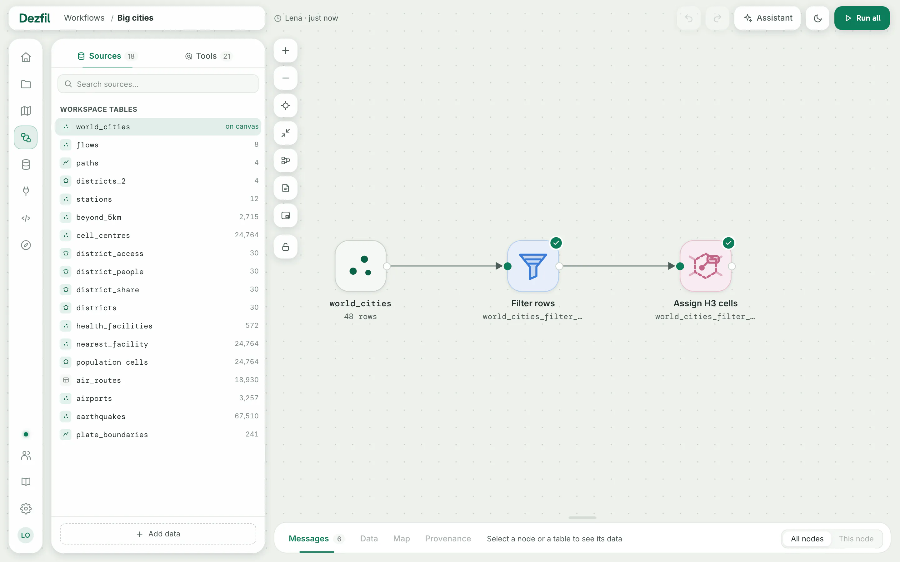
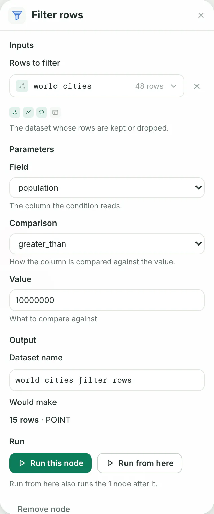
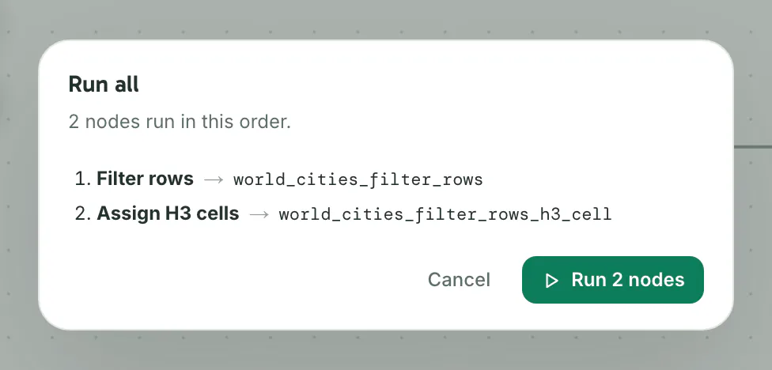

A workflow is a chain of tools on a canvas. Each tool is a node that reads a dataset and writes a new one, and a run carries the nodes in order.

- **Time:** about 10 minutes.
- **You need:** the `world_cities` dataset from [Your first map](../start/first-map.md). Any dataset of points with a number column works the same way.

## 1. Create a workflow

1. Open **Workflows** in the side menu.
2. Click **New workflow**.
3. Type a name, such as `Big cities`.
4. Click **Create**.

You should see an empty canvas that reads **No nodes yet**, and on its left a pane with two tabs, **Sources** and **Tools**.

## 2. Add a source

In **Sources**, click **world_cities** under **Workspace tables**. You can also drag the row onto the canvas.

You should see a **world_cities** tile on the canvas, and its row in the pane marked **on canvas**.

For a dataset that is not in the list yet, click **Add data** at the foot of the pane. The dataset you import lands on the canvas as a source.

## 3. Add a tool

1. Click the **world_cities** tile to select it.
2. Open **Tools** in the pane.
3. Click **Filter rows**.

You should see a **Filter rows** tile beside the source, linked to it. Under it stands the dataset it will write, `world_cities_filter_rows`, its name cut short to fit.

A tool you add while a tile is selected reads that tile's dataset, when it can.

To link two tiles yourself, drag from the port on the right of one tile to an input port on the left of another. A line at the foot of the canvas names the link, such as **Linked world_cities into Rows to filter.**

## 4. Set the tool

Click the **Filter rows** tile. Its panel opens at the right of the canvas.

1. Under **Parameters**, set **Field** to **population**.
2. Set **Comparison** to **greater_than**.
3. Type `10000000` in **Value**.

You should see **15 rows · POINT** under **Would make**. Dezfil tries the node on your data while you set it, so you see what it makes before you run it.

Every change saves as you make it. **Dataset name** under **Output** is the name the result gets in **Data**. Change it before the first run: after that, the dataset keeps its name.

## 5. Chain a second tool

1. With **Filter rows** still selected, click **Assign H3 cells** in **Tools**.
2. Click the new tile.
3. Set **Resolution** to `3`.
4. Turn on **Boundary**.

You should see an **Assign H3 cells** tile linked to the filter, writing `world_cities_filter_rows_h3_cell`. Its panel says **The preview comes after world_cities_filter_rows is produced.** A node can read a result that is not made yet.

**Boundary** draws each city as the hexagon of the H3 cell it falls in. A low **Resolution** makes large cells.

## 6. Run the workflow

1. Click **Run all** at the top right.
2. The **Run all** dialog lists the nodes in the order they run, each with the dataset it writes. Click **Run 2 nodes**.

You should see **running** and a count of nodes beside the button, then **Completed · 2 nodes**. Each node's tile shows a check mark. The results band opens under the canvas on **Messages**, the log of every run.

While a run is going, **Run all** turns into **Cancel**. A workflow runs one run at a time.

Each node's result is a dataset in **Data**, where a workflow's results sit together in one folder card. Its **Open workflow** brings you back to the canvas.

## 7. Look at a result

1. Click the **Assign H3 cells** tile.
2. In the results band, click **Map**.

You should see 15 small marks on the map, one cell for each city of more than ten million people, and 15 features in the corner. At this size each cell is a few pixels wide: scroll on one to zoom in on its hexagon.

**Data** shows the same dataset's first rows. **Provenance** names the tool that made it, when it ran, what it read and the SQL it ran.

To draw the result on a map, click **Add to a map**, then **New map** or one of your maps. The map builder opens with the result as a layer.

## 8. Change a node and run it again

1. Click the **Filter rows** tile.
2. Change **Value** to `15000000`.

   You should see **Edited. Run to apply.** at the top of the panel, with the old and the new value. The dataset keeps the last run's rows until the next run. **Discard edit** puts the old value back.

3. Click **Run from here** in the panel.
4. In the dialog, click **Run 2 nodes**.

   You should see **Completed · 2 nodes**, and the results band count 5 rows for the filter's dataset.

Three buttons start a run:

| Button | Where | What it runs |
|---|---|---|
| **Run all** | Top right | Every node, in order. A dialog lists them first. |
| **Run from here** | A node's panel, when other nodes read from it | The node and every node that reads from it. A dialog lists them first. |
| **Run this node**, or **Run again** once it has made a dataset | A node's panel | The node alone. |

After you run a node alone, the nodes that read from it say **Stale.** until they run too.

## What a node tells you

A node's tile wears a small badge for most states. Point at a tile for its state in words, or open its panel, which says it at the top:

| The panel says | What it means | What to do |
|---|---|---|
| **Edited. Run to apply.** | You changed a node that has made a dataset. Its dataset still holds the last run. | Run it, or click **Discard edit**. |
| **Stale.** | A dataset it reads has new data, or the node it reads from ran again or is itself stale. The panel names which. | Run it again. When the node it reads from is itself stale, click **Run from here** on that node, or **Run all**. |
| **The last run failed.** | The run stopped on the error shown under it. Any dataset from an earlier run stands. | Fix what the error names and run it again. |
| **Cannot run.** | A dataset it reads is gone, or comes from a node that cannot run. | Link another input, or bring the dataset back. |
| **Output deleted.** | The dataset this node made was deleted. | Run it again to make it. |
| **Unavailable on this instance.** | The tool needs an outside service this instance has not set up. | Ask an admin to set up the service the panel names. |

On the **Workflows** page, each card sums up its workflow in one chip, such as **Up to date**, **Never run**, **2 to run again** or **1 failed**. The **Needs attention** filter keeps the workflows with a node to look at.

## The tools

**Tools** lists the tools in six groups: **Data**, **Overlay**, **Proximity**, **Geometry**, **Aggregation** and **Statistics**. Click a tool to add it in view, or drag it to the spot you want. Its search box finds a tool by its name or by what it does: type `join`, `buffer` or `summarize`, for example.

In a panel, small icons under each input show the kinds of geometry it takes.

**SQL step** has no input ports: it reads the datasets its query names, so you change what it reads by changing its query. [Query with SQL](sql.md) covers writing one.

## Arrange the canvas

The buttons at the top left of the canvas change how it looks, never what it runs:

| Button | What it does |
|---|---|
| **Arrange by dependency** | Lays the tiles out in the order they read each other. |
| **Add a note** (N) | Lets you click or drag on the canvas to place a note, for whoever reads the workflow. |
| **Fill the screen**, **Framed view** | Lets the canvas fill the window, or puts it back in its frame. |
| **Lock canvas** | Stops every change until you unlock it, so nothing moves or links by accident. |

**Undo** and **Redo** sit in the top bar. To rename the workflow, click its name there.

## Manage your workflows

The **Workflows** page lists your workflows as cards. Search them by name, or filter them by **All**, **Needs attention** or **Never run**.

Hover a card for its buttons, and point at one to read its name. **Add to a project** and **Delete workflow** show on your own workflows only.

| Button | What it does |
|---|---|
| **Duplicate** | Makes a copy with `copy` after its name. The copy's nodes write datasets of their own, and it has not run. |
| **Add to a project**, or **Move to another project** once it is in one | Files the workflow in a project, for the people you share it with. |
| **Delete workflow** | Deletes it on a second click. The datasets it made stay in **Data**. |

To take one node out, click **Remove node** at the foot of its panel. The dialog says whether its dataset stays.

## Troubleshooting

**A link is refused with a sentence such as "Features to buffer needs point, line, polygon geometry".** The dataset has no geometry, or the wrong kind. For a table of coordinates, open it in **Data** and click **Set geometry**, as [Your first map](../start/first-map.md#troubleshooting) shows.

**A link is refused with "That would make a loop".** Two nodes cannot read each other, directly or through other nodes. Link the other way round, or read another dataset.

**A node's run buttons are greyed out, and the line under them says "A run is in flight."** A run is going, perhaps started by someone else. Wait for it, or click **Cancel** at the top right.

**A run is refused with "Too many operations are already queued".** The instance is busy. Click **Retry** once other runs finish.

**Nothing on the canvas moves or links, and it says "Canvas locked".** Click **unlock**. A reload also starts the canvas unlocked.

**A change is not kept, and the canvas says "This item has changed. Reload it before trying again."** The page holds an older copy of the workflow: someone else changed it, or you ran a node you had edited. Click **Reload** at the top of the canvas, click **Reload** again to confirm, then make the change again.

**A panel says "You can view this but cannot make this change."** You are a **Viewer** in the workflow's project: ask the project's owner to make you an **Editor**. Everyone sees a workflow this way while its owner's account is deactivated.

## Next steps

- Start from a finished workflow: [Templates](templates.md).
- Ask the assistant to explain a node or a failed run: [The assistant](assistant.md).
- Write your own step in SQL: [Query with SQL](sql.md).
- Run workflows from a script or an AI agent: [How the API works](../api/http-api.md) and [Connect an AI agent](../api/mcp.md).
